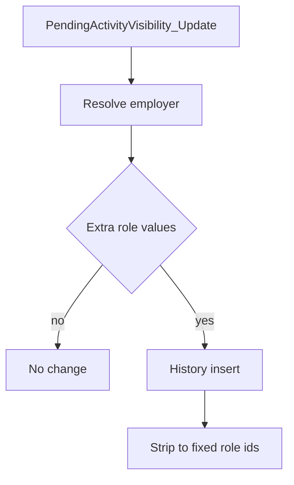

# SP_SEP_SeparationConfig_PendingActivityVisibility_Update

## What it does

When a workflow is deleted, if the employer's active resignation configuration stores pending-activity visibility roles beyond the fixed `-1`/`-2`/`-3` values, archives that configuration row to history and rewrites the three pending-activity role CSVs so only those fixed values remain.

The script begins with `USE [HRM-CL-Prod]`.

## Parameters

| Name | Direction | What it is for |
|---|---|---|
| `@workflowId` | in | Deleted workflow; used to resolve employer |

## Call sequence

Calls no other procedures or functions.

## Callers

| Object | Kind | Page |
|---|---|---|
| `SP_AdminWM_RemoveDetailsById` | procedure | [SP_AdminWM_RemoveDetailsById](/docs/database/hrms/SP_AdminWM_RemoveDetailsById) |

## Nested

Calls no other procedures or functions.

## Steps

1. Read `EmployerId` from `TWorkflowManagement` for `@workflowId` (`SP_SEP_SeparationConfig_PendingActivityVisibility_Update.sql`).
2. If active resignation config has any pending-activity role values other than `-1`/`-2`/`-3`, continue; else do nothing further in that branch.
3. Insert the current `TResignationConfigurationData` row into `TResignationConfigurationData_History`.
4. Update the three pending-activity role columns to keep only `-1`/`-2`/`-3` (or empty).

## Tables

| Table | Read or write |
|---|---|
| `TWorkflowManagement` | read |
| `TResignationConfigurationData` | read then write |
| `TResignationConfigurationData_History` | write |

## Flow

