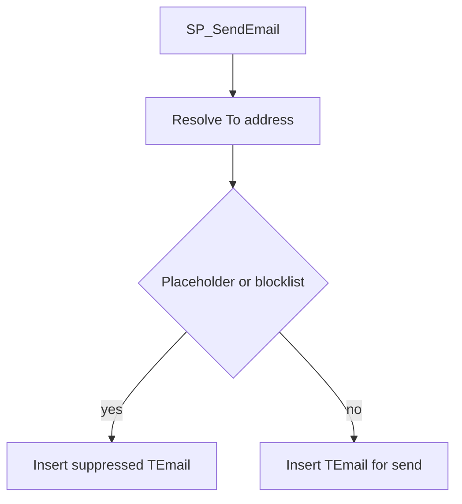

# SP_SendEmail

## What it does

Queues an outbound email by inserting into `TEmail`. Resolves the To address from `@emailTONotify`, else from `@emailTOEmployeeID`, else from HR-role employees for `@EmployerId`. Some placeholder / blocked subjects skip the normal send path and still insert a row with different sent flags.

## Parameters

| Name | Direction | What it is for |
|---|---|---|
| `@emailTOEmployeeID` | in | Employee whose email is used when notify list is empty; `0` allowed |
| `@emailSubJect` | in | Subject |
| `@emailBody` | in | Body |
| `@attachmentPath` | in | Optional attachment |
| `@emailTONotify` | in | Explicit To addresses |
| `@Emailfrom` | in | From address |
| `@EmployerId` | in | Optional HR-role fan-out when no To is given |
| `@EmailCC` / `@EmailBCC` | in | Optional CC/BCC |
| `@EmailNotificationId` | in | Optional link to `TEmailNotification` |

## Call sequence

Calls no other procedures or functions.

## Callers

Many application callers (Offer Rolled Out uses it from `SendOfferLetterToCandidate`). No other procedure inventory search was expanded beyond this feature pass.

## Nested

Calls no other procedures or functions.

## Steps

1. Resolve `@emailToEmailID` from notify list, employee row, or employer HR roles.
2. If subject/body look like unresolved placeholders or match blocklist patterns, insert a suppressed `TEmail` row.
3. Otherwise insert a normal `TEmail` row for the mailer to pick up.

## Tables

| Table | Read or write |
|---|---|
| `temployee` | read |
| `tuseremployee` | read |
| `tusers` | read |
| `troles` | read |
| `temail` | write |

## Flow

