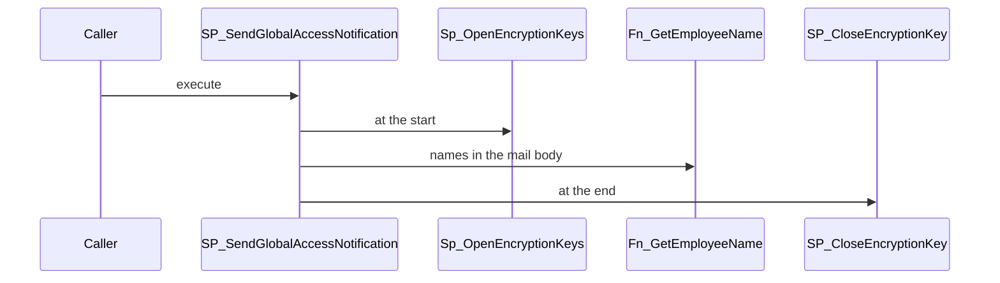
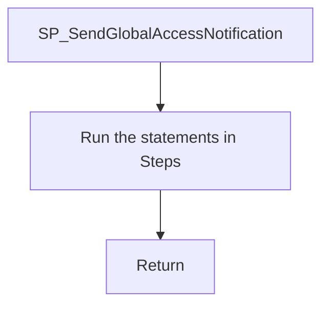

# SP_SendGlobalAccessNotification

## What it does

Queues email rows in TEmail when a user is granted global access. One mail goes to the employee. Further mails go to admin and HR addresses collected for the parent, child, and sibling organizations. The header comment names Access Right Management as the reason.

## Parameters

| Name | Direction | What it is for |
|---|---|---|
| `@userID` | in | User who received global access |
| `@employerId` | in | Employer |
| `@UpdateBy` | in | Employee who made the change |

## Call sequence

## Callers

| Object | Kind | Page |
|---|---|---|
| `SP_AdminRoleM_ChangeuserRole` | procedure | [SP_AdminRoleM_ChangeuserRole](/docs/database/hrms/SP_AdminRoleM_ChangeuserRole) |
| `SP_ApproveAdminChangesRequest` | procedure | No page yet |
| `SP_ChangeuserRole` | procedure | No page yet |
| `SP_CM_ApproveAdminChangesRequest` | procedure | No page yet |

## Nested

| Object | Kind | When | Page |
|---|---|---|
| `Sp_OpenEncryptionKeys` | procedure | at the start | [Sp_OpenEncryptionKeys](/docs/database/hrms/Sp_OpenEncryptionKeys) |
| `Fn_GetEmployeeName` | function | names in the mail body | [Fn_GetEmployeeName](/docs/database/hrms/Fn_GetEmployeeName) |
| `SP_CloseEncryptionKey` | procedure | at the end | [SP_CloseEncryptionKey](/docs/database/hrms/SP_CloseEncryptionKey) |

## Steps

1. Open encryption keys and read the employee, employment number, organization, and role.
2. Build the subject and HTML body.
3. Insert a TEmail row to the employee.
4. Insert further TEmail rows for the admin and HR recipients of related organizations.
5. Close encryption keys.

## Tables

| Table | Read or write |
|---|---|
| `TUsers` | read |
| `TUserEmployee` | read |
| `TEmployee` | read |
| `TEmployeeInfo` | read |
| `TEmployerDetails` | read |
| `TRoles` | read |
| `TEmail` | write |

## Flow

