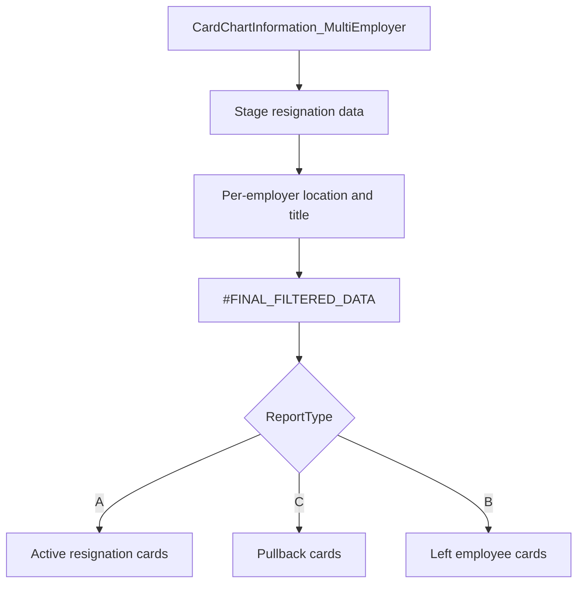

# SP_SeparationDashBoard_CardChartInformation_MultiEmployer

## What it does

Builds the Separation Dashboard summary cards for multi-employer filters. Reuses the same latest-resignation / status / experience staging pattern as the chart SP, enriches rows with designation, work location, skills, age range, and tenure helpers, then returns one result set of `Name` / `Value` / `SUBVALUE` rows that differ by `@ReportType`:

- `A` — Total Active Resignations, Top Reason This Month, Resignations Awaiting Approval  
- `C` — Total Pullback Count, Pullback Reason Breakdown  
- `B` — Total Left Employees, Attrition Rate (%), Early Attrition (less than 1 year), Average Tenure at Exit

`@LoginID` is used when calling nested location-scope helpers per employer.

## Parameters

| Name | Direction | What it is for |
|---|---|---|
| `@ReportType` | in | `A` / `B` / `C` (same meaning as the chart SP) |
| `@LoginID` | in | Logged-in employee id for nested location scope |
| `@EmployerIDs` | in | Comma-separated employer ids |
| `@BusinessUnitID` | in | BU filter or `ALL` |
| `@BaseLocationID` | in | Location filter or `ALL` |
| `@FromDate` / `@ToDate` | in | Primary window |
| `@CompFromDate` / `@CompToDate` | in | Optional comparison window |

## Call sequence

```mermaid
sequenceDiagram
  participant Caller
  participant Main as SP_SeparationDashBoard_CardChartInformation_MultiEmployer
  participant Open as Sp_OpenEncryptionKeys
  participant Loc as SP_EmployeeDashboard_GetLocationByEmployeeId
  participant Title as SP_CM_GetTitle
  Caller->>Main: execute
  Main->>Open: EXEC
  loop each EmployerId
    Main->>Loc: EXEC LoginID CurEmployerID
    Main->>Title: EXEC CurEmployerID
  end
  Main->>Main: card SELECT by ReportType
```

## Callers

| Object | Kind | Page |
|---|---|---|
| `seperationDashboardDAL.GetCardsDataForSeparationDashboard` | app | [Separation Dashboard](/docs/guides/separation/separation-dashboard) |

## Nested

| Object | Kind | Page |
|---|---|---|
| `Sp_OpenEncryptionKeys` | procedure | [Sp_OpenEncryptionKeys](/docs/database/hrms/Sp_OpenEncryptionKeys) |
| `SP_EmployeeDashboard_GetLocationByEmployeeId` | procedure | [SP_EmployeeDashboard_GetLocationByEmployeeId](/docs/database/hrms/SP_EmployeeDashboard_GetLocationByEmployeeId) |
| `SP_CM_GetTitle` | procedure | [SP_CM_GetTitle](/docs/database/hrms/SP_CM_GetTitle) |
| `Fn_GetEmployeeName` | function | [Fn_GetEmployeeName](/docs/database/hrms/Fn_GetEmployeeName) |

## Steps

From `HRMS-DATABASE/HRMS/STOREPROCEDURE/SP_SeparationDashBoard_CardChartInformation_MultiEmployer.sql`:

1. Open encryption keys; normalize BU/location/date defaults.
2. Stage latest resignations and `#Resignation_Data` for the selected employers and report-type filters; compute Status / Experience; apply Active/InActive and BU/location deletes.
3. Cursor over employer ids; fill `@WorkLocation` via `SP_EmployeeDashboard_GetLocationByEmployeeId` and `@Designation` via `SP_CM_GetTitle`.
4. Build helper temps (`#SkillCategory`, `#CurrentExperience`, `#AGERANGE`) and `#FINAL_FILTERED_DATA`.
5. For `B`, compute average headcount from opening/closing active counts on `TEmployeeInfo`.
6. Emit the card UNION ALL SELECT for the active `@ReportType`.

## Tables

| Table | Read or write |
|---|---|
| `dbo.TResignationDetails` | read |
| `dbo.TEmployeeInfo` | read |
| `dbo.TEmployee` | read |
| `dbo.torghierarchydetails` | read |
| `dbo.TResignation` | read |
| `dbo.tLocation` | read |
| `dbo.TMEmploymentTypes` | read |
| `dbo.TSeparationType` | read |
| `dbo.TORGChart` | read |
| `dbo.TRequestWorkflows` | read |
| `dbo.TActivityDetails` | read |
| `dbo.TEmployeeSkillDetails` / `dbo.TMSkills` | read |
| `dbo.TEmployeeRoleMaster` | read |
| `dbo.TGender` | read |

## Unresolved calls

None.

## Flow


