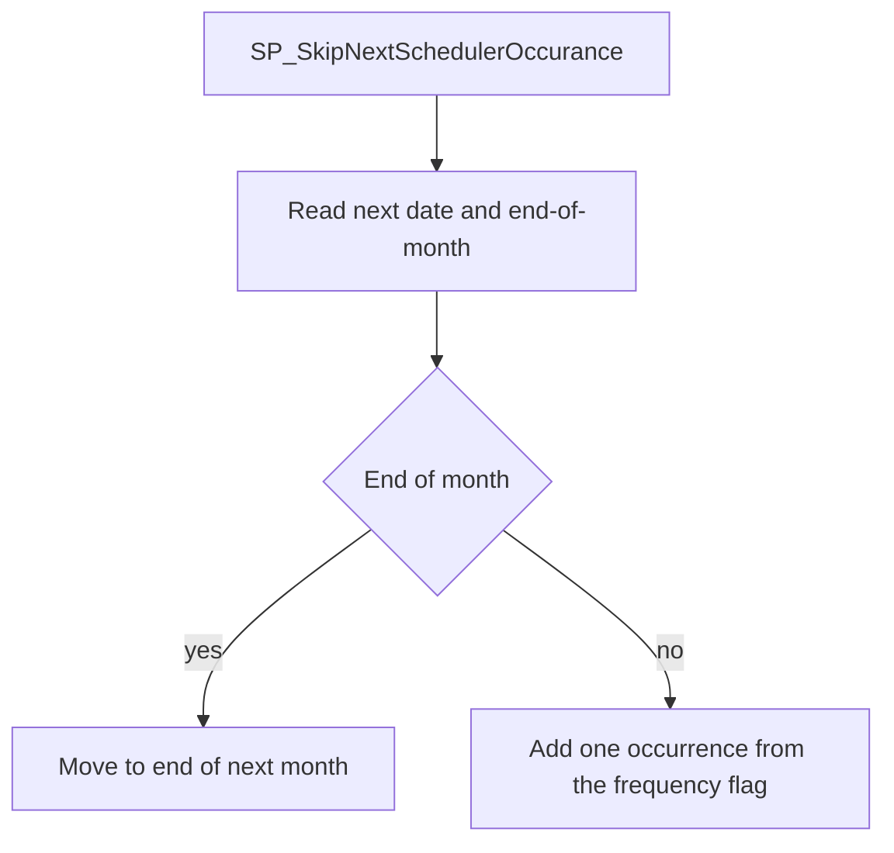

# SP_SkipNextSchedulerOccurance

## What it does

Moves `NextExecutionDate` forward by one occurrence. End-of-month schedules go to the last day of the following month. Other schedules add one hour, day, week, month, or year from the matching frequency flag. It does not set the `SkipNext` bit.

## Parameters

| Name | Direction | What it is for |
|---|---|---|
| `@Id` | in | Schedule id |

## Call sequence

Calls no other procedures or functions.

## Callers

Procedures and functions that call this object.

No other procedure or function calls this object.

## Nested

Calls no other procedures or functions.

## Steps

1. In `HRMS-DATABASE/HRMS/STOREPROCEDURE/SP_SkipNextSchedulerOccurance.sql`, read `NextExecutionDate` and `IsEndOfMonth` from `TSchedulers` for `@Id`.

2. When `IsEndOfMonth` is 1, set `NextExecutionDate` to `EOMONTH` of one month after the current next date.

3. Otherwise set `NextExecutionDate` with `DATEADD` of one hour, day, week, month, or year, chosen by `IsHourly`, `IsDaily`, `IsWeekly`, `IsMonthly`, or `IsYearly`.

## Tables

| Table | Read or write |
|---|---|
| `TSchedulers` | read and write |

## Flow

