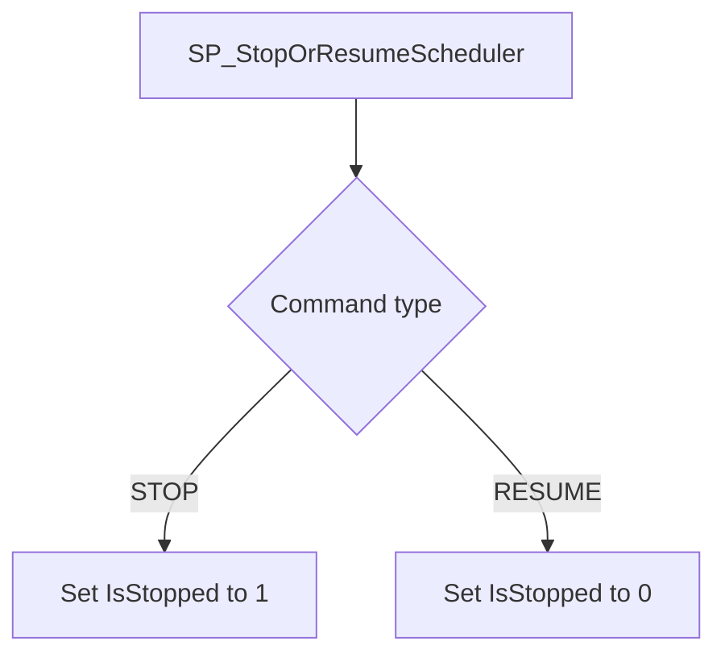

# SP_StopOrResumeScheduler

## What it does

Sets `IsStopped` on one schedule. `STOP` sets it to 1. `RESUME` sets it to 0. Any other command text does nothing. The header comment mentions the skip-next flag. This script updates `IsStopped` only.

## Parameters

| Name | Direction | What it is for |
|---|---|---|
| `@Id` | in | Schedule id |
| `@CommandType` | in | `STOP` or `RESUME` |

## Call sequence

Calls no other procedures or functions.

## Callers

Procedures and functions that call this object.

No other procedure or function calls this object.

## Nested

Calls no other procedures or functions.

## Steps

1. In `HRMS-DATABASE/HRMS/STOREPROCEDURE/SP_StopOrResumeScheduler.sql`, when `@CommandType` is `STOP`, set `IsStopped` = 1 for `@Id`.

2. When `@CommandType` is `RESUME`, set `IsStopped` = 0 for `@Id`.

## Tables

| Table | Read or write |
|---|---|
| `TSchedulers` | write |

## Flow

