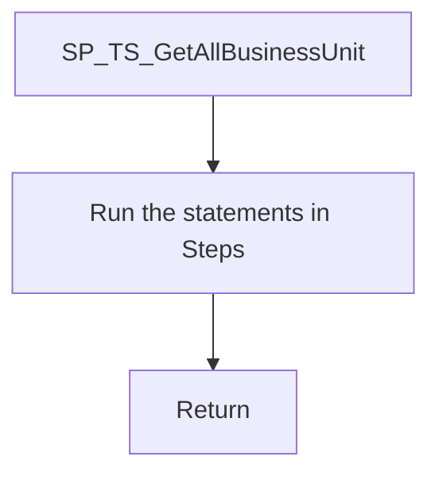

# SP_TS_GetAllBusinessUnit

## What it does

Returns active, non-deleted business units for an employer with parent unit name appended.

## Parameters

| Name | Direction | What it is for |
|---|---|---|
| `@EmployerId` | in | Employer id |

## Call sequence

Calls no other procedures or functions.

## Callers

No other procedure or function calls this object.

## Nested

Calls no other procedures or functions.

## Steps

1. Select UnitId and UnitName with parent name in parentheses from torghierarchydetails.
2. Filter IsActive = Y, isdelete = N, parentunitid <> 0.
3. Order by UnitName.

## Tables

| Table | Read or write |
|---|---|
| `dbo.torghierarchydetails` | read |

## Flow

