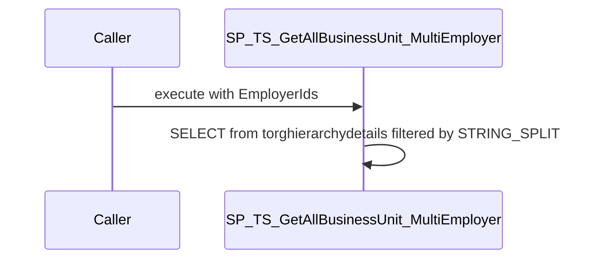
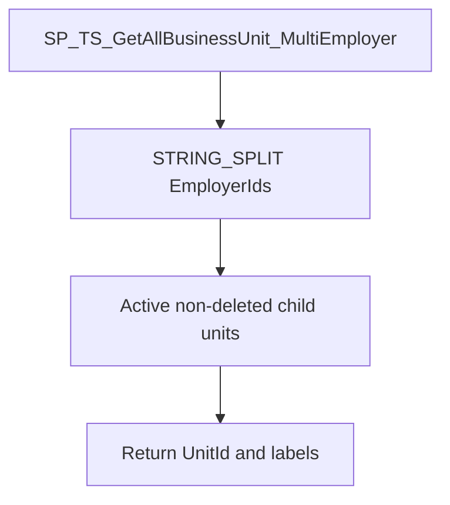

# SP_TS_GetAllBusinessUnit_MultiEmployer

## What it does

Returns active, non-deleted business units for one or more employers passed as a comma-separated `@EmployerIds` list. Each row includes employer id, unit id, a display name that appends the parent unit name in parentheses, and `BusinessUnitTitile` (same as the raw unit name) for UI dropdowns. Child units only (`parentunitid <> 0`).

## Parameters

| Name | Direction | What it is for |
|---|---|---|
| `@EmployerIds` | in | Comma-separated employer ids (for example `10,12,15`) |

## Call sequence

Calls no other procedures or functions.

## Callers

| Object | Kind | Page |
|---|---|---|
| `seperationDashboardDAL.GetBusinessUnits` | app | [Separation Dashboard](/docs/guides/separation/separation-dashboard) |

## Nested

Calls no other procedures or functions.

## Steps

From `HRMS-DATABASE/HRMS/STOREPROCEDURE/SP_TS_GetAllBusinessUnit_MultiEmployer.sql`:

1. Split `@EmployerIds` with `STRING_SPLIT` and match `torghierarchydetails.EmployerId`.
2. Keep rows where `IsActive = 'Y'`, `isdelete = 'N'`, and `parentunitid <> 0`.
3. Build `UnitName` as `UnitName(parentUnitName)` via a correlated subquery on the same table; expose `BusinessUnitTitile` as the plain unit name.
4. Order by employer then unit name.

## Tables

| Table | Read or write |
|---|---|
| `dbo.torghierarchydetails` | read |

## Unresolved calls

None.

## Flow

