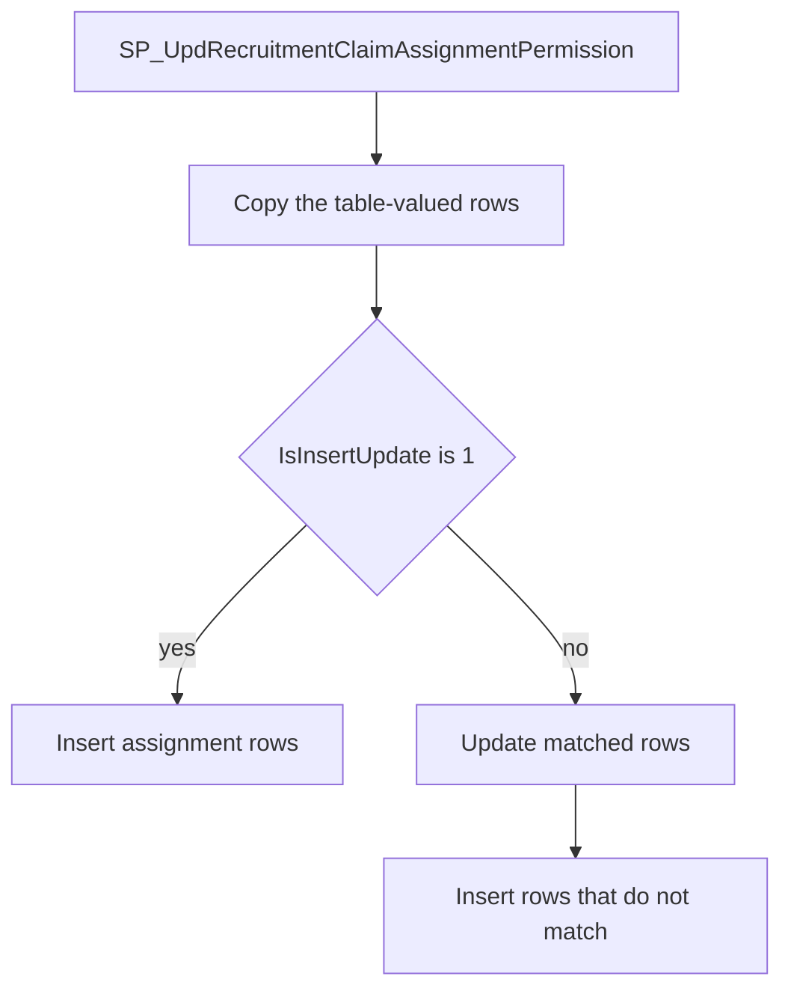

# SP_UpdRecruitmentClaimAssignmentPermission

## What it does

Writes role rows into `TRecruitmentClaim_ASSIGNMENT`. `@IsInsertUpdate` 1 inserts every row from the table-valued parameter. Any other value updates rows that already have an assignment id and inserts rows that do not.

## Parameters

| Name | Direction | What it is for |
|---|---|---|
| `@EmployerId` | in | Organisation stored on each row |
| `@UDT_RecruitmentClaim_ASSIGNMENT` | in | `UDT_TRecruitmentClaim_ASSIGNMENT` |
| `@CreatedBy` | in | Actor. Also stored as `UpdatedBy` on update |
| `@IsInsertUpdate` | in | 1 inserts. Other values update, then insert missing rows |

## Call sequence

Calls no other procedures or functions.

## Callers

No other procedure or function calls this object.

`recruitmentDAL.SaveUpdateRecruitmentDashboardsPermissions` calls it from Recruitment Management. That method fills role id and leaves employee id null.

## Nested

Calls no other procedures or functions.

## Steps

1. Copy assignment id, claim id, role id, and active flag from the table-valued parameter into `#RecruitmentClaim_ASSIGNMENT` (`SP_UpdRecruitmentClaimAssignmentPermission.sql`).
2. When `@IsInsertUpdate` is 1, insert those rows into `TRecruitmentClaim_ASSIGNMENT` with the employer and `@CreatedBy`.
3. Otherwise update existing rows matched on `RecruitmentClaim_Assignm_ID` and employer, then insert rows whose assignment id, role, claim, and employer do not already match.

## Tables

| Table | Read or write |
|---|---|
| `TRecruitmentClaim_ASSIGNMENT` | write |

## Flow

