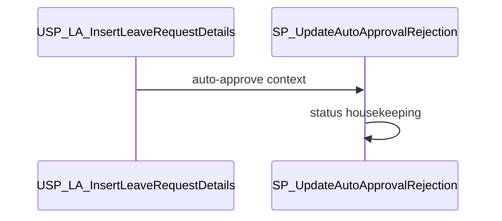
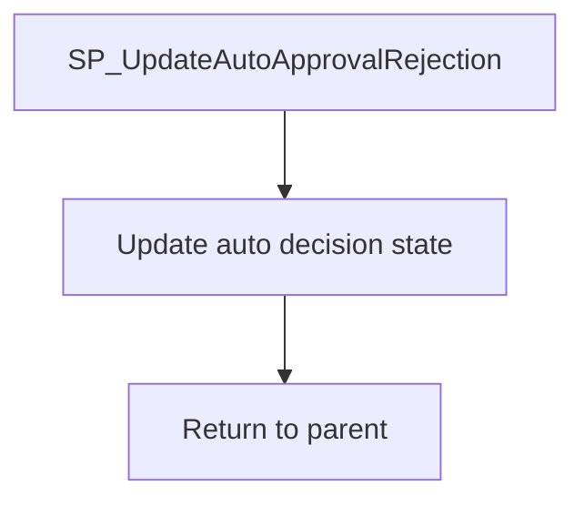

# SP_UpdateAutoApprovalRejection

## What it does

Helper invoked from leave insert auto-approve / rejection housekeeping paths to align request status and related side effects when a leave is decided without a multi-level workflow.

## Parameters

See script — parent leave insert supplies request context after `USP_LA_InsertLeaveRequestDetails` decides the auto path.

## Call sequence

## Callers

| Object | Kind | Page |
|---|---|---|
| `USP_LA_InsertLeaveRequestDetails` | procedure | [USP_LA_InsertLeaveRequestDetails](/docs/database/hrms/USP_LA_InsertLeaveRequestDetails) |

## Nested

Further nests inside the script are outside this one-level pass.

## Steps

1. Script is `HRMS-DATABASE/HRMS/STOREPROCEDURE/SP_UpdateAutoApprovalRejection.sql`.
2. Apply auto-approval/rejection housekeeping for the request.

## Tables

| Table | Read or write |
|---|---|
| Request / workflow status tables | read/write |

## Unresolved calls

Inner EXECs not expanded.

## Flow

