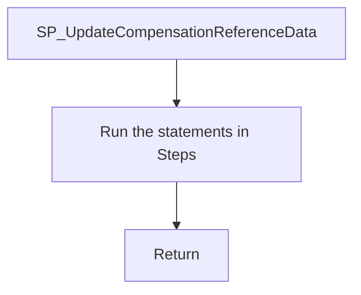

# SP_UpdateCompensationReferenceData

## What it does

Updates reference text and last-modified fields for one ReferenceId. ReferenceType is not updated (parameter accepted but commented out in SET).

## Parameters

| Name | Direction | What it is for |
|---|---|---|
| `@ReferenceId` | in | Row to update |
| `@ReferenceText` | in | New text |
| `@ReferenceType` | in | Passed but not written |
| `@LastModifiedBy` | in | Actor employee id |

## Call sequence

Calls no other procedures or functions.

## Callers

No other procedure or function calls this object.

## Nested

Calls no other procedures or functions.

## Steps

1. UPDATE TCompensationReferenceData set ReferenceText, LastModifiedBy, LastModifiedDate where ReferenceId matches.

## Tables

| Table | Read or write |
|---|---|
| `dbo.TCompensationReferenceData` | write |

## Flow

