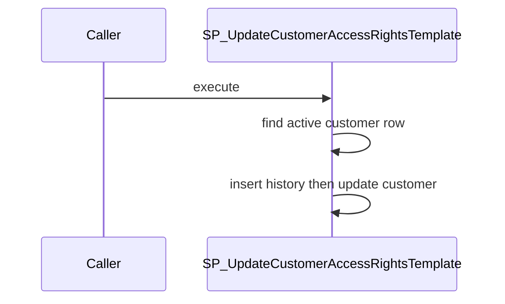
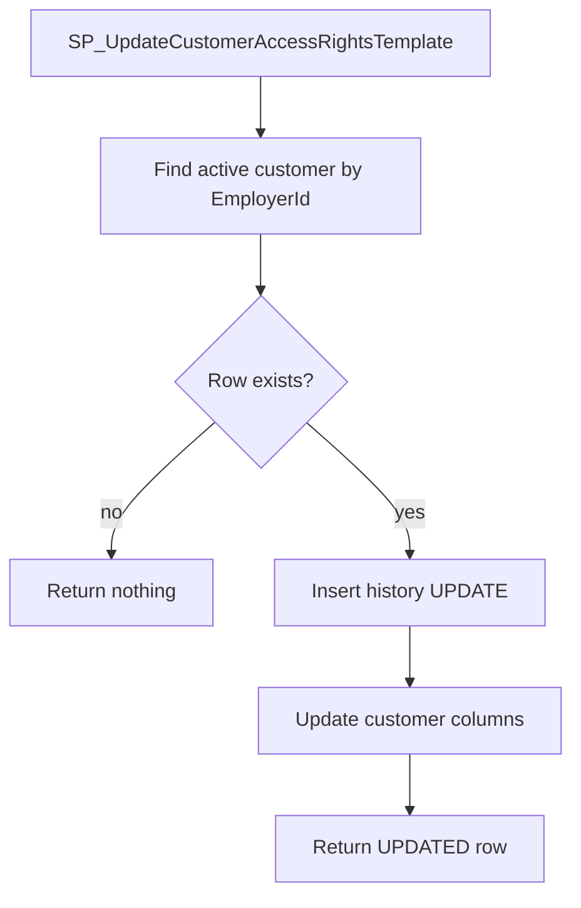

# SP_UpdateCustomerAccessRightsTemplate

## What it does

Updates the active customer access-rights template for one employer. Before the update it copies the current row into `TAccessRightsTemplateCustomer_History` with action `UPDATE`, then returns the updated row plus `OperationType = UPDATED`. The script object name is `sp_UpdateCustomerAccessRightsTemplate` (SQL Server case-insensitive; DAL executes `SP_UpdateCustomerAccessRightsTemplate`).

If no active customer template exists for the employer, the procedure does nothing and returns no result set. Create/seed is done by inline INSERT in Core Node, not this proc.

## Parameters

| Name | Direction | What it is for |
|---|---|---|
| `@DefaultVersion` | in | Platform default template version this customer row tracks |
| `@CustomerVersion` | in | Customer-side version number |
| `@JsonData` | in | Full customer template JSON |
| `@EmployerId` | in | Employer owning the customer template |
| `@ModifiedBy` | in | Employee/user who saved |

## Call sequence

Calls no other procedures or functions.

## Callers

Procedures and functions that call this object.

No other procedure or function calls this object. Application caller: Core Node `AccessRightsManagementDAL.saveCustomerAccessRightsTemplate` via `PUT /api/accessRightsManagement/customerTemplate`.

## Nested

Calls no other procedures or functions.

## Steps

1. `SET NOCOUNT ON` inside `TRY`.

2. Resolve `@ExistingTemplateId` from `TAccessRightsTemplateCustomer` where `EmployerId` matches and `IsActive = 1`.

3. When a row exists: insert the current columns into `TAccessRightsTemplateCustomer_History` with `Action = 'UPDATE'` and `HistoryDate = GETDATE()`.

4. Update `DefaultVersion`, `CustomerVersion`, `JsonData`, `ModifiedBy`, `ModifiedDate` on the active customer row.

5. Select the updated row plus `'UPDATED' AS OperationType`.

6. On error, `THROW`.

## Tables

| Table | Read or write |
|---|---|
| `TAccessRightsTemplateCustomer` | read, write |
| `TAccessRightsTemplateCustomer_History` | write |

## Unresolved calls

None.

## Flow

