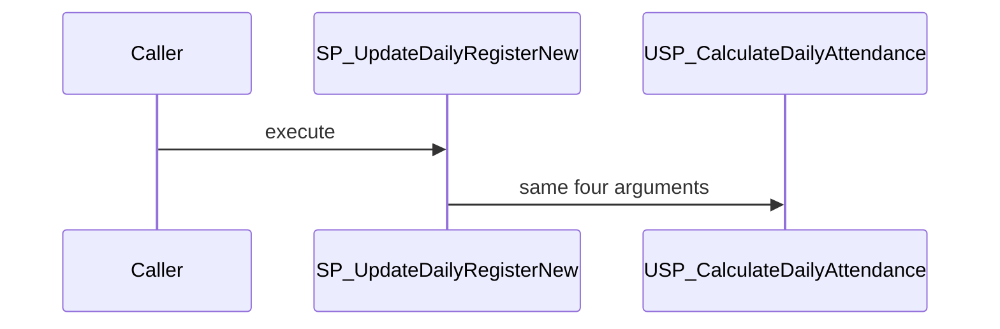
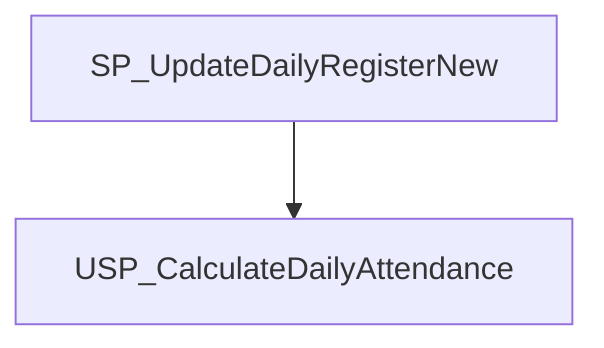

# SP_UpdateDailyRegisterNew

## What it does

Recalculates daily attendance for one employee across a date range. The body is a single call to `USP_CalculateDailyAttendance`. Temporary-card allocation uses it with the allocation date as both ends of the range.

## Parameters

| Name | Direction | What it is for |
|---|---|---|
| `@AttendanceCalculationFromDate` | in | First day to recalculate. Optional |
| `@AttendanceCalculationToDate` | in | Last day to recalculate |
| `@Employee` | in | Employee. Optional |
| `@Source` | in | Why the recalculation ran, such as `TemporaryCardMapping` |

## Call sequence

## Callers

| Object | Kind | Page |
|---|---|---|
| `Sp_AdminAM_InsTempCardDet` | procedure | [Sp_AdminAM_InsTempCardDet](/docs/database/hrms/Sp_AdminAM_InsTempCardDet) |

## Nested

| Object | Kind | When | Page |
|---|---|---|---|
| `USP_CalculateDailyAttendance` | procedure | always | No page yet |

## Steps

1. `EXEC dbo.USP_CalculateDailyAttendance` with the four parameters unchanged.

## Tables

This procedure names no tables. The write happens inside `USP_CalculateDailyAttendance`.

## Flow

