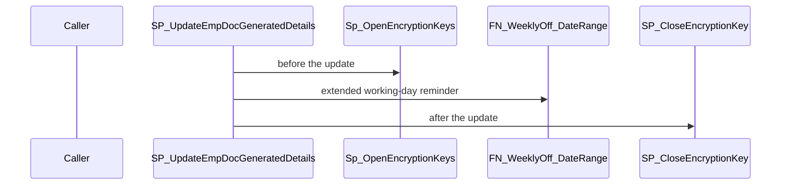
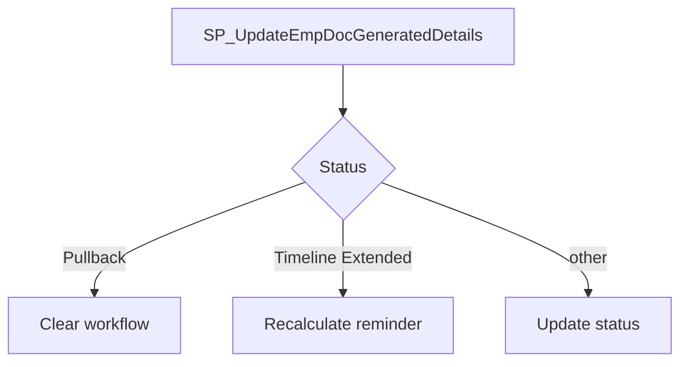

# SP_UpdateEmpDocGeneratedDetails

## What it does

Updates a generated document for pullback, timeline extension, or a new status. Pullback deletes the DocumentBuilderESS workflow rows. Accepted By Employee also inserts an employee attachment. Timeline Extended recalculates the reminder date.

## Parameters

| Name | Direction | What it is for |
|---|---|---|
| `@DocumentGenerationID` | in | Generated document |
| `@Status` | in | Pullback, Timeline Extended, or another status |
| `@EmployerId` | in | Employer |
| `@IsExtended` | in | Extension flag |
| `@ExtendedExpiryDate` | in | New expiry when the timeline is extended |
| `@UpdatedBy` | in | Editor |
| `@Comments` | in | Comment stored with the status |
| `@FileName` | in | Optional file name used when the status is Accepted By Employee |

## Call sequence

## Callers

No other procedure or function calls this object.

## Nested

| Object | Kind | When | Page |
|---|---|---|---|
| `Sp_OpenEncryptionKeys` | procedure | before the update | [Sp_OpenEncryptionKeys](/docs/database/hrms/Sp_OpenEncryptionKeys) |
| `FN_WeeklyOff_DateRange` | function | extended working-day reminder | [FN_WeeklyOff_DateRange](/docs/database/hrms/FN_WeeklyOff_DateRange) |
| `SP_CloseEncryptionKey` | procedure | after the update | [SP_CloseEncryptionKey](/docs/database/hrms/SP_CloseEncryptionKey) |

## Steps

1. Open encryption keys and look up the status id (`SP_UpdateEmpDocGeneratedDetails.sql`).
2. Pullback sets status, deletes `tRequestWorkFlows` for DocumentBuilderESS, and inserts a status detail.
3. Timeline Extended recalculates the reminder with `FN_WeeklyOff_DateRange` when the template uses working days, and sets `IsTimeLineExtended`.
4. Any other status updates the row. Accepted By Employee also inserts `TEmployeeAttachment`.
5. Close the encryption key.

## Tables

| Table | Read or write |
|---|---|
| `dbo.TEmployeeDocumentGeneratedDetails` | read and write |
| `dbo.tEmpDocGenerated_MasterStatus` | read |
| `dbo.tRequestWorkFlows` | write |
| `dbo.TEmpDocGenerated_StatusDetails` | write |
| `dbo.TDocumentTemplates` | read |
| `dbo.TEmployeeAttachment` | write |

## Flow

