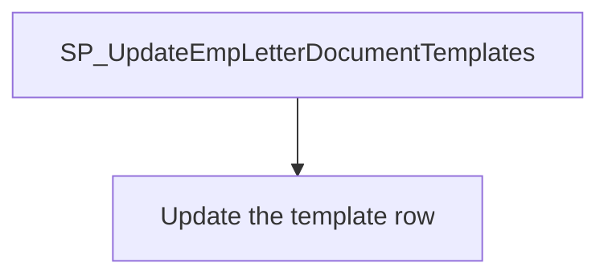

# SP_UpdateEmpLetterDocumentTemplates

## What it does

Updates one row in TEmpLetterDocumentTemplates by document id. It does not change the document type.

## Parameters

| Name | Direction | What it is for |
|---|---|---|
| `@DocumentId` | in | Row to update |
| `@DocumentName` | in | Name |
| `@DocumentDescription` | in | Description |
| `@Templatemodule` | in | Module text |
| `@DocumentPath` | in | Path |
| `@DocumentFields` | in | Placeholders |
| `@Updatedby` | in | Editor |
| `@Employerid` | in | Passed and not written |
| `@IsActive` | in | Y or N |
| `@ModuleId` | in | Module id |
| `@EmployeeAcceptance` | in | Acceptance flag |
| `@EnableAcceptanceTimeline` | in | Timeline flag |
| `@NoofDays` | in | Days |
| `@Timeline` | in | Day type |
| `@ReminderFrequency` | in | Reminder |
| `@CategoryId` | in | Categories |
| `@EnableAcknowledgement` | in | Acknowledgement flag |

## Call sequence

Calls no other procedures or functions.

## Callers

No other procedure or function calls this object.

## Nested

Calls no other procedures or functions.

## Steps

1. Update the matching `TEmpLetterDocumentTemplates` row and set `Updatedate` to now (`SP_UpdateEmpLetterDocumentTemplates.sql`).

## Tables

| Table | Read or write |
|---|---|
| `dbo.TEmpLetterDocumentTemplates` | write |

## Flow

