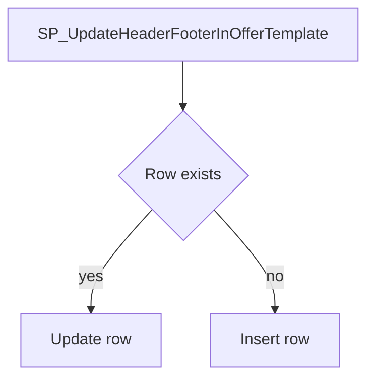

# SP_UpdateHeaderFooterInOfferTemplate

## What it does

Upserts header/footer/watermark image paths and margins for a document in `TOfferLetterHeaderFooter`. Updates the existing row when one exists for the document and employer; otherwise inserts a new active row.

## Parameters

| Name | Direction | What it is for |
|---|---|---|
| `@useDefault` | in | Use employer defaults |
| `@headerImg` | in | Header image path |
| `@footerImg` | in | Footer image path |
| `@watermarkImg` | in | Watermark image path |
| `@marginLeft` | in | Left margin |
| `@marginRight` | in | Right margin |
| `@marginTop` | in | Top margin |
| `@marginBottom` | in | Bottom margin |
| `@documentid` | in | Document template id |
| `@EmployerId` | in | Employer |
| `@CreatedBy` | in | Actor employee |
| `@IsActive` | in | Active flag on insert |

## Call sequence

Calls no other procedures or functions.

## Callers

No other procedure or function calls this object. `DocBuilderDAL.InsertHeaderFooterDetails` executes it from Doc Builder after optional image file writes.

## Nested

Calls no other procedures or functions.

## Steps

1. Count rows for `@documentid`.
2. When a row exists, update images, margins, `UseDefault`, and creator fields for that document and employer.
3. Otherwise insert a new `TOfferLetterHeaderFooter` row.

## Tables

| Table | Read or write |
|---|---|
| `dbo.TOfferLetterHeaderFooter` | read, write |

## Unresolved calls

None.

## Flow

