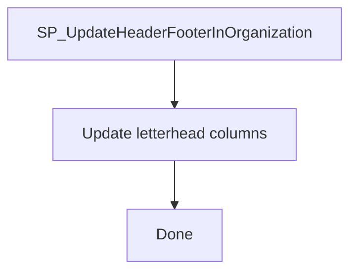

# SP_UpdateHeaderFooterInOrganization

## What it does

Stores the header, footer, and watermark file paths and the letterhead height and opacity on one employer. The parameter is named CustId, and the statement filters TEmployerDetails.Employerid.

## Parameters

| Name | Direction | What it is for |
|---|---|---|
| `@headerImg` | in | Header image path |
| `@footerImg` | in | Footer image path |
| `@watermarkImg` | in | Watermark image path |
| `@CustId` | in | Value compared to Employerid |
| `@HeaderHeight` | in | Header height. Null becomes 84 |
| `@FooterHeight` | in | Footer height. Null becomes 70 |
| `@Opacity` | in | Opacity. Null becomes 0.3 |

## Call sequence

Calls no other procedures or functions.

## Callers

Procedures and functions that call this object.

No other procedure or function calls this object.

## Nested

Calls no other procedures or functions.

## Steps

1. Update headerImage, footerImage, watermarkImage, HeaderHeight, FooterHeight, and Opacity on TEmployerDetails where Employerid equals @CustId.

## Tables

| Table | Read or write |
|---|---|
| `TEmployerDetails` | write |

## Flow

