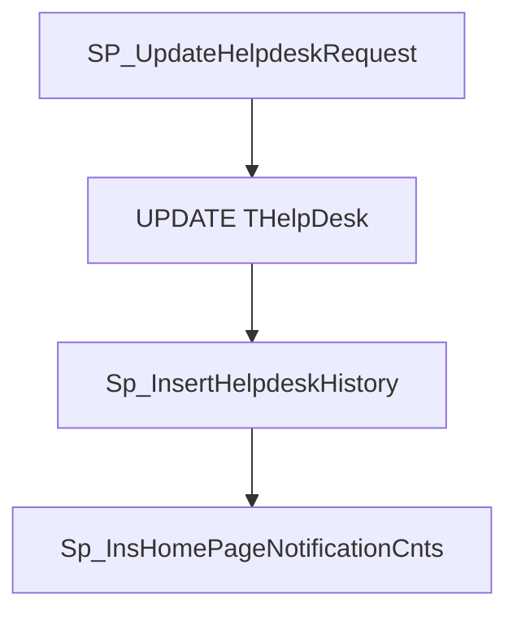

# SP_UpdateHelpdeskRequest

## What it does

Updates an existing help-desk request owners, status, comments, tree keys, documents, and details; appends history; adjusts home-page notification counts.

## Parameters

| Name | Direction | What it is for |
|---|---|---|
| `@HelpdeskRequestId` | in | Request id |
| `@ActivityOwners` | in | Owner list |
| `@RequestStatus` | in | New status |
| `@UpdatedBy` | in | Actor |
| `@HRComments` | in | Owner comments |
| `@HD_GroupID / @HD_CategoryID / @HD_ActivityID` | in | Tree keys |
| `@SupportDocument / @RequestDetails` | in | Docs and details |
| `@EmployerId` | in | Employer |

## Call sequence

Calls nested procedures listed under Nested when present; otherwise runs inline SQL only.

## Callers

| Object | Kind |
|---|---|
| `HelpDeskDAL.UpdateHelpDeskRequest` | procedure |
| `ViewHelpdeskDetails.aspx.cs` | application |

## Nested

- [`Sp_InsertHelpdeskHistory`](/docs/database/hrms/Sp_InsertHelpdeskHistory)
- [`Sp_InsHomePageNotificationCnts`](/docs/database/hrms/Sp_InsHomePageNotificationCnts)

## Steps

1. UPDATE THelpDesk fields.
2. Exec Sp_InsertHelpdeskHistory.
3. Exec Sp_InsHomePageNotificationCnts with pending-action delta.
4. Return success scalar for the DAL.

## Tables

| Table | Read or write |
|---|---|
| `THelpDesk` | write |
| `THelpDeskHistory` | write via nested |

## Unresolved calls

None noted for this feature pass.

## Flow

