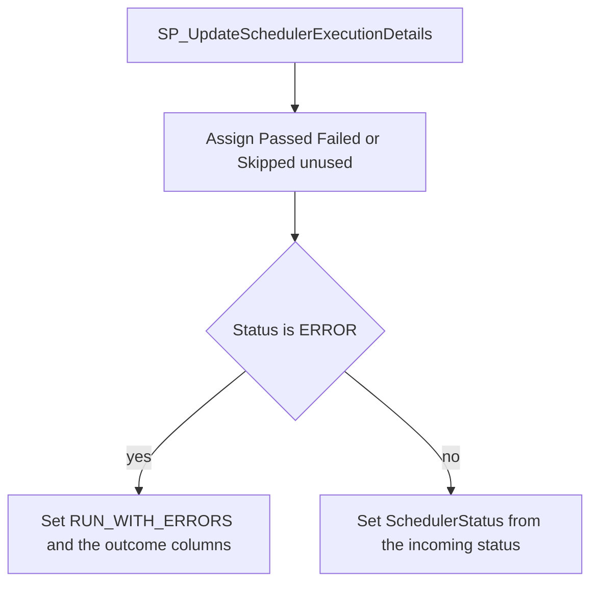

# SP_UpdateSchedulerExecutionDetails

## What it does

Writes the outcome of one run onto `TSchedulers`: scheduler status, updated count, error text, execution type, and who ran it. An `ERROR` status also sets `Status` to `RUN_WITH_ERRORS`. Skip and Run now both call this before inserting the transaction row.

## Parameters

| Name | Direction | What it is for |
|---|---|---|
| `@Id` | in | Schedule id |
| `@Status` | in | `SUCCESS`, `SUCCESSFUL`, `ERROR`, `SKIPPED`, or another short status |
| `@UpdatedCount` | in | Processed-record count |
| `@Error` | in | Error text, up to 250 characters |
| `@ExecutionType` | in | `System`, `Manual`, or `DB` as sent by the caller |
| `@ExecutedBy` | in | Person or blank |

## Call sequence

Calls no other procedures or functions.

## Callers

Procedures and functions that call this object.

No other procedure or function calls this object.

## Nested

Calls no other procedures or functions.

## Steps

1. In `HRMS-DATABASE/HRMS/STOREPROCEDURE/SP_UpdateSchedulerExecutionDetails.sql`, set `@SchedulerStatus` to `Passed`, `Failed`, or `Skipped` for `SUCCESS` / `SUCCESSFUL`, `ERROR`, and `SKIPPED`. That variable is not used in either update.

2. When `@Status` is `ERROR`, set `Status` = `RUN_WITH_ERRORS`, `SchedulerStatus` = `@Status`, `UpdatedCount`, `Error`, `ExecutionType`, and `ExecutedBy`.

3. Otherwise set `SchedulerStatus` = `@Status` and the same count, error, execution type, and executed-by columns. Leave `Status` unchanged on this branch.

## Tables

| Table | Read or write |
|---|---|
| `TSchedulers` | write |

## Flow

