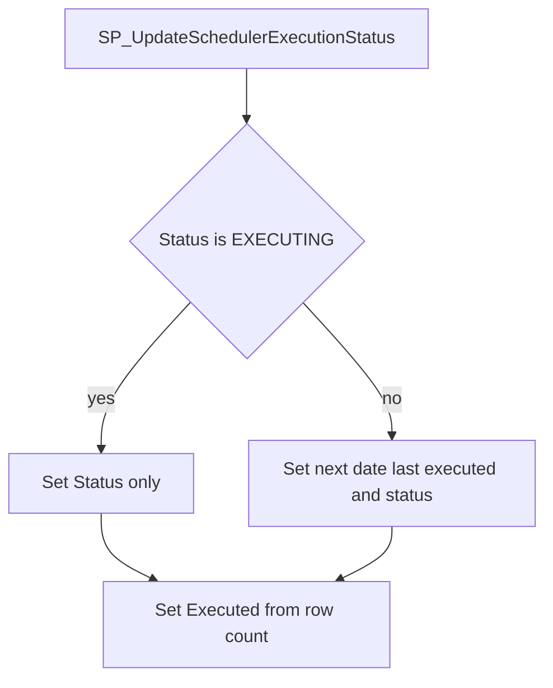

# SP_UpdateSchedulerExecutionStatus

## What it does

Updates one schedule's status. `EXECUTING` changes only `Status`. Any other status also sets `NextExecutionDate` from the parameter and `LastExecuted` to `GETDATE()`. Run now calls it twice, first with `EXECUTING` and then with `COMPLETED`.

## Parameters

| Name | Direction | What it is for |
|---|---|---|
| `@Id` | in | Schedule id |
| `@NextExecutionDate` | in | Next run. Applied only when status is not `EXECUTING` |
| `@Executed` | in/out | Set to `@@ROWCOUNT` |
| `@Status` | in | New status, such as `EXECUTING` or `COMPLETED` |

## Call sequence

Calls no other procedures or functions.

## Callers

Procedures and functions that call this object.

No other procedure or function calls this object.

## Nested

Calls no other procedures or functions.

## Steps

1. In `HRMS-DATABASE/HRMS/STOREPROCEDURE/SP_UpdateSchedulerExecutionStatus.sql`, when `@Status` is `EXECUTING`, set `Status` on `TSchedulers` for `@Id`.

2. Otherwise set `NextExecutionDate`, `LastExecuted` = `GETDATE()`, and `Status` for `@Id`.

3. Set `@Executed` to `@@ROWCOUNT`.

## Tables

| Table | Read or write |
|---|---|
| `TSchedulers` | write |

## Flow

