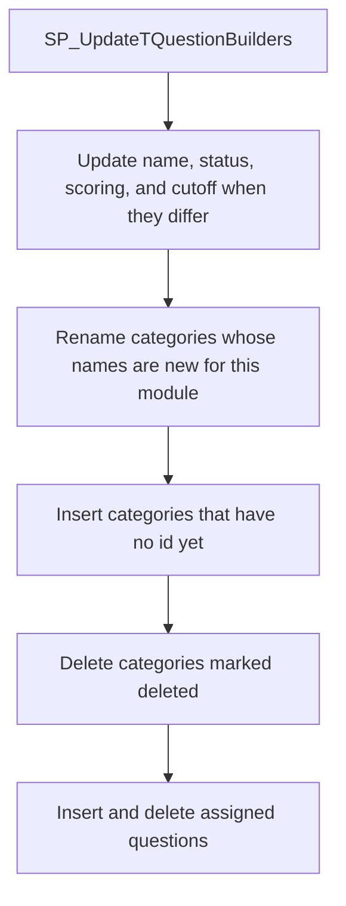

# SP_UpdateTQuestionBuilders

## What it does

Updates a live interview template. It changes the header name, active flag, scoring flag, and cutoff only when the stored value differs. It then renames categories, inserts categories that have no id yet, deletes categories marked deleted, and reconciles the assigned questions for the remaining categories. It does not update `TTemplateModule`.

## Parameters

| Name | Direction | What it is for |
|---|---|---|
| `@TemplateName` | in | New template name |
| `@CreatedBy` | in | Employee stored as the creator on newly inserted category and question rows |
| `@ModuleId` | in | Passed by the caller. This procedure does not write it |
| `@EmployerId` | in | Employer stored on a newly inserted category |
| `@IsActive` | in | Active flag compared and written on the header, and stored on a new category |
| `@UDT_QuestionCategory` | in | `UDT_TQuestionCategory` rows for the categories and questions to keep, add, or delete |
| `@TemplateId` | in | Template header id |
| `@TemplateModuleId` | in | Module-map id used when inserting or matching categories |
| `@IsInterviewScoringEnabled` | in | Scoring flag compared and written on the header |
| `@CutoffScore` | in | Cutoff compared and written on the header |

## Call sequence

Calls no other procedures or functions.

## Callers

No other procedure or function calls this object. `recruitmentDAL.UpdateQuestionBuilder` calls it inside a DAL transaction for `POST /api/recruitment/updateQuestionBuilder`.

## Nested

Calls no other procedures or functions.

## Steps

1. Copy `@UDT_QuestionCategory` into `@All`, including `IsDeleted` (`SP_UpdateTQuestionBuilders.sql`).
2. When the header's `TemplateName` differs, update `TExitInterviewTemplate.TemplateName` for that `Transid` where `Isdeleted` is 0 and `IsActive` is 1.
3. When the header's `IsActive` differs, update `IsActive` where `Isdeleted` is 0.
4. When `IsInterviewScoringEnabled` differs, update it where `Isdeleted` is 0 and `IsActive` is 1. When `CutoffScore` differs, update it under the same filter.
5. When a category name in `@All` is missing for `@TemplateModuleId`, set `TTemplateModuleCategory.CategoryName` from the matching category id.
6. When any `@All` row has a null `TemplateModuleCategoryId`, insert those distinct names into `TTemplateModuleCategory`, copy the new ids back onto `@All`, and insert `TAssignedQuestions` rows that do not already exist for that category and are not marked deleted.
7. When any `@All` row has `IsDeleted` 1, delete the matching `TTemplateModuleCategory` rows and the `TAssignedQuestions` rows for those category ids.
8. When an assigned question for a category is not the incoming question id and the incoming row is not deleted, delete assigned questions for that category that are absent from `@All`, then insert questions that are not already active on the template.
9. When a category in `@All` has no `TAssignedQuestions` row yet, insert the non-deleted questions that are not already active on the template.

## Tables

| Table | Read or write |
|---|---|
| `TExitInterviewTemplate` | read and write |
| `TTemplateModuleCategory` | read and write |
| `TAssignedQuestions` | read and write |

## Flow

