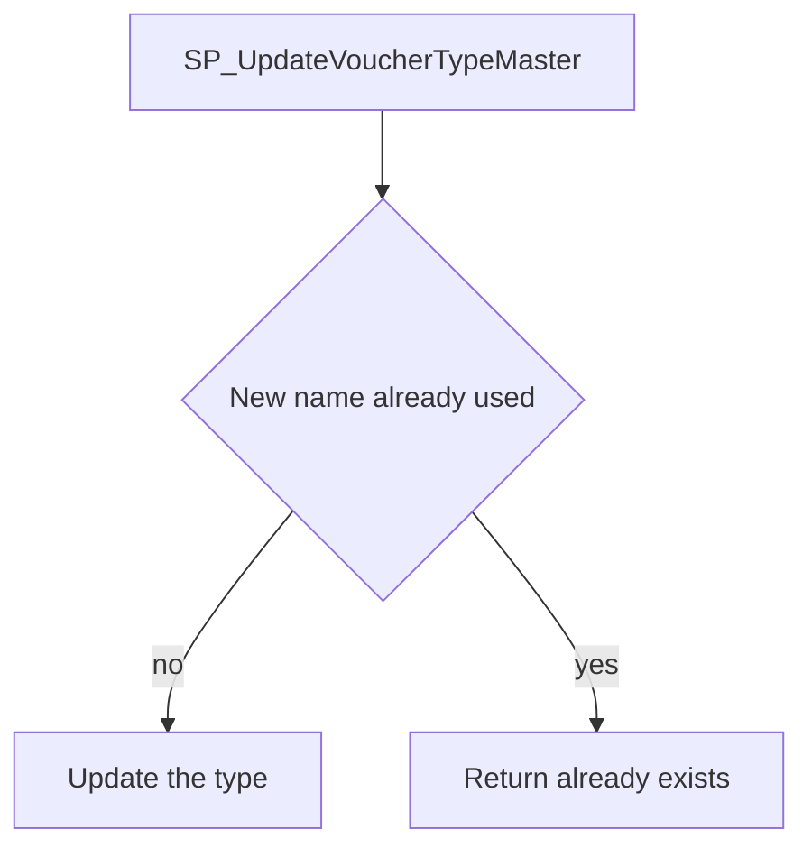

# SP_UpdateVoucherTypeMaster

## What it does

Updates one voucher type. A renamed type is refused when another row for the same employer already uses the new name.

## Parameters

| Name | Direction | What it is for |
|---|---|---|
| `@VoucherTypeID` | in | Type to update |
| `@Name` | in | New name |
| `@EmployerID` | in | Employer used in the duplicate check |
| `@ModifiedBy` | in | Employee who saved |
| `@IsActive` | in | Y or N |
| `@VoucherAmount` | in | Replacement amount list |
| `@MaxAmount` | in | Optional monthly cap |

## Call sequence

Calls no other procedures or functions.

## Callers

No other procedure or function calls this object.

## Nested

Calls no other procedures or functions.

## Steps

1. Read the current name for `@VoucherTypeID` (`SP_UpdateVoucherTypeMaster.sql`).
2. When the name changed, count other rows for the same employer and name.
3. When that count is 0, update name, modified by, modified date, active flag, amounts, and max amount, then return error code 0.
4. Otherwise return error code 1 and leave the row unchanged.

## Tables

| Table | Read or write |
|---|---|
| `dbo.TvoucherTypeMaster` | read and write |

## Flow

