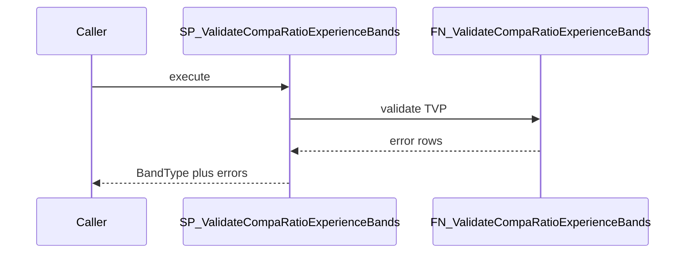
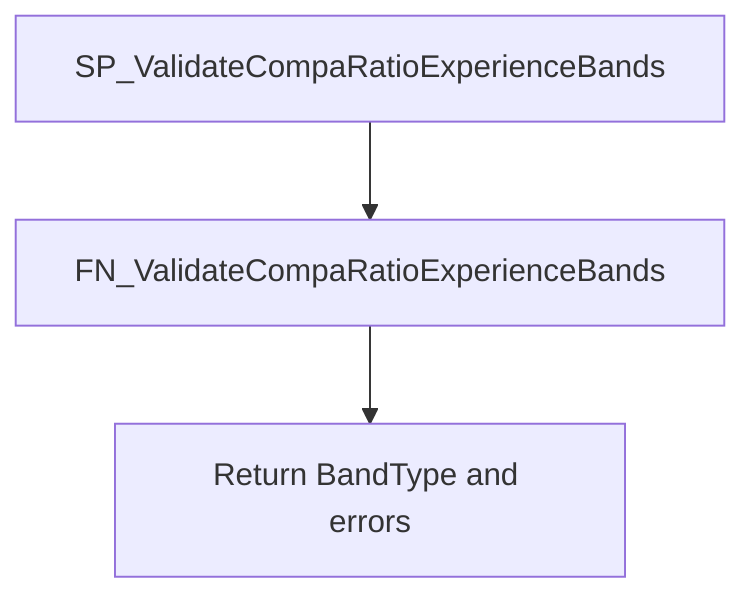

# SP_ValidateCompaRatioExperienceBands

## What it does

Validates a proposed Experience or Skill Experience band TVP without writing anything. Returns one row per error (gap, overlap, Max less than Min, first band not starting at 0, and Required checks when `@IsSaveAttempt = 1`). Prefixes each row with the caller's `@BandType`.

## Parameters

| Name | Direction | What it is for |
|---|---|---|
| `@BandType` | in | `EXP` or `SKILLEXP` echoed on each error row |
| `@Bands` | in | `UDT_CompensationExperienceBand` proposed bands |
| `@IsSaveAttempt` | in | When 1, also emit Required Min/Max errors |

## Call sequence

## Callers

Procedures and functions that call this object.

No other procedure or function calls this object. Node DAL `ValidateCompaRatioExperienceBands` executes it for live and save-time band checks on the Admin Configuration screen. Save-path validation inside `SP_InsertUpdateCompaRatioConfig` calls `FN_ValidateCompaRatioExperienceBands` directly.

## Nested

| Object | Kind | When | Page |
|---|---|---|---|
| `FN_ValidateCompaRatioExperienceBands` | function | always | [FN_ValidateCompaRatioExperienceBands](/docs/database/hrms/FN_ValidateCompaRatioExperienceBands) |

## Steps

1. Select `@BandType` plus every column from `FN_ValidateCompaRatioExperienceBands(@Bands, @IsSaveAttempt)` (`STOREPROCEDURE/SP_ValidateCompaRatioExperienceBands.sql`).

2. Order by SortOrder then ErrorCode. No tables are written.

## Tables

| Table | Read or write |
|---|---|
| _(none)_ | TVP only; nested function may call `FN_GetExperienceBandLabel` |

## Flow

