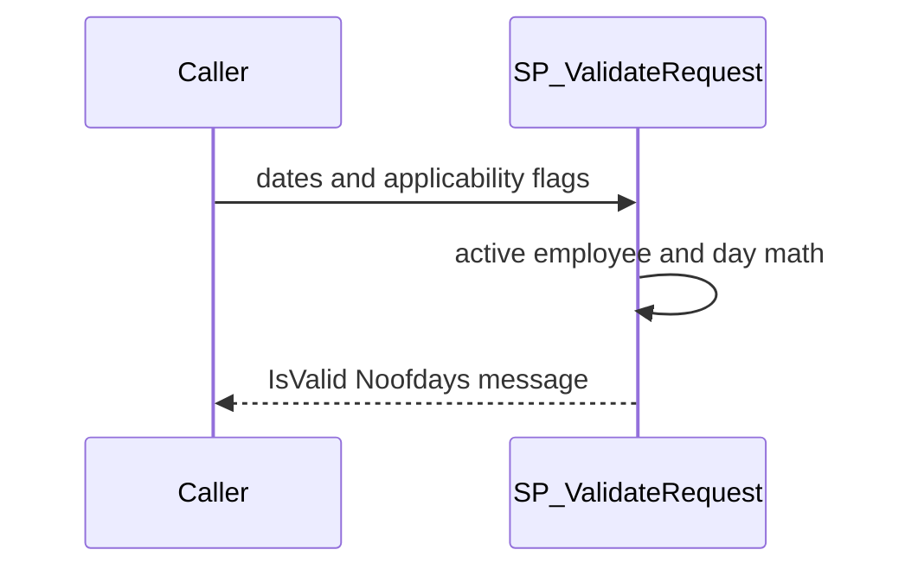
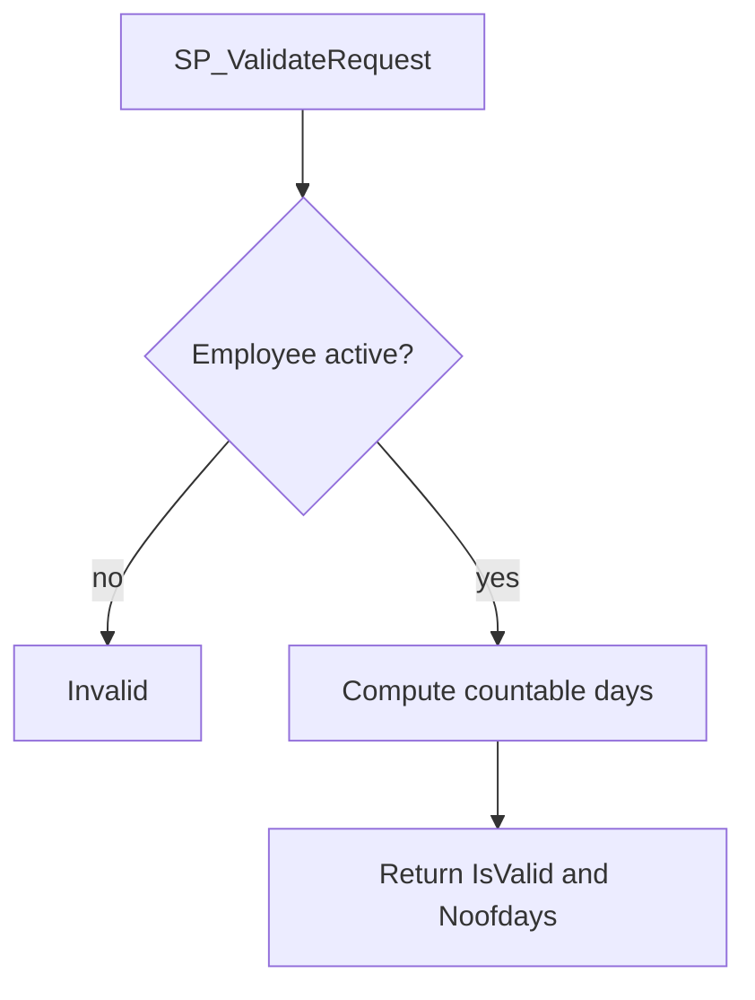

# SP_ValidateRequest

## What it does

Shared AR/WFH date-range validator. Checks the employee is active, computes day count with week-off / holiday applicability flags, and returns `@IsValid`, `@Out_Message`, and `@Noofdays`.

## Parameters

| Name | Direction | What it is for |
|---|---|---|
| `@Employeeid` | in | Employee |
| `@Fromdate` / `@ToDate` | in | Range |
| `@IsHalfDay` | in | Half-day flag |
| `@RequestSource` | in | Caller context |
| `@IsApplicableOnWeekOff` / `@IsApplicableOnHoliday` | in | Count rules |
| `@Out_Message` / `@IsValid` / `@Noofdays` | out | Result |

## Call sequence

## Callers

`SP_LA_AddAttendanceRegularisationDetails`, `SP_LA_AddWorkFromHomeRequestDetails`.

## Nested

No procedure EXECs; may use weekly-off helper functions inline.

## Steps

1. Resolve employer and active flag for employee.
2. Walk date range applying week-off/holiday rules.
3. Output validity, message, and day count.

## Tables

| Table | Read or write |
|---|---|
| `TEmployee` | read |
| Holiday / weekly-off sources | read |

## Unresolved calls

Weekly-off helper function names not expanded on this page.

## Flow

