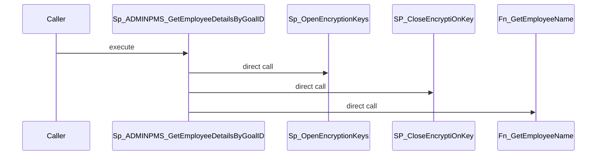
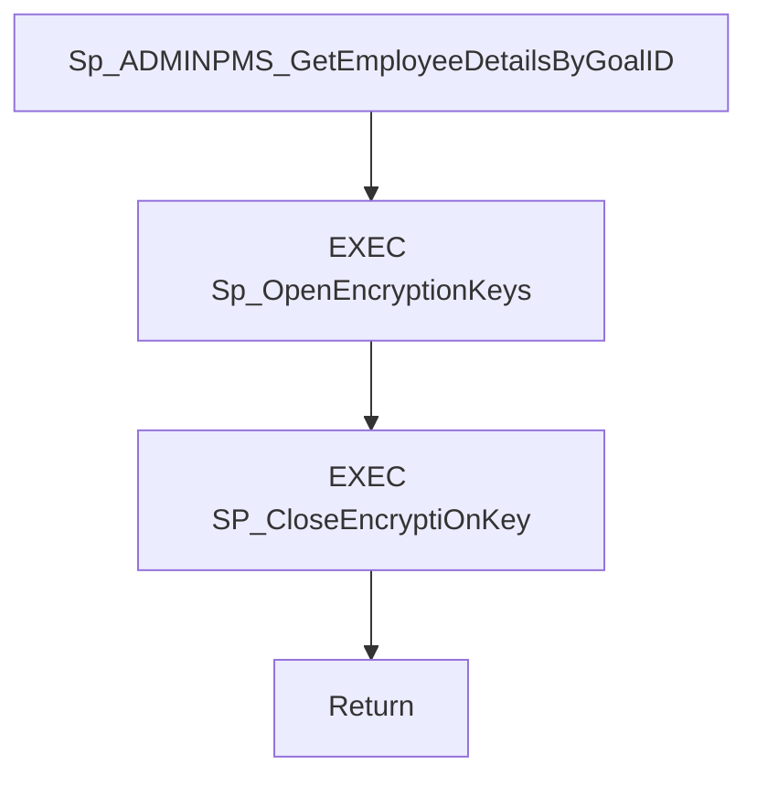

# Sp_ADMINPMS_GetEmployeeDetailsByGoalID

## What it does

Stored procedure `Sp_ADMINPMS_GetEmployeeDetailsByGoalID`. Reads `TTitle`, `TPMSEmployerConfiguration`, `TOrgHierarchyDetails`, `TMEmploymentTypes`, `TEmployee`, `TEmployeeInfo`, `TPMSEmployeeGoalMapping`, `TPMSEmployeeGoalSetting`, and others. Calls `Sp_OpenEncryptionKeys`, `SP_CloseEncryptiOnKey`, `Fn_GetEmployeeName`.

## Parameters

| Name | Direction | What it is for |
|---|---|---|
| `@GoalSettingId` | in | Int |
| `@EmployerId` | in | Int |
| `@Employeeid` | in | INT, default 0 |

## Call sequence

## Callers

No other procedure or function calls this object.

## Nested

| Object | Kind | When | Page |
|---|---|---|---|
| `Sp_OpenEncryptionKeys` | procedure | direct call | [Sp_OpenEncryptionKeys](/docs/database/hrms/Sp_OpenEncryptionKeys) |
| `SP_CloseEncryptiOnKey` | procedure | direct call | [SP_CloseEncryptiOnKey](/docs/database/hrms/SP_CloseEncryptiOnKey) |
| `Fn_GetEmployeeName` | function | direct call | [Fn_GetEmployeeName](/docs/database/hrms/Fn_GetEmployeeName) |

## Steps

1. Script is `HRMS-DATABASE/HRMS/STOREPROCEDURE/Sp_ADMINPMS_GetEmployeeDetailsByGoalID.sql`.
2. EXEC Sp_OpenEncryptionKeys
3. EXEC SP_CloseEncryptiOnKey

## Tables

| Table | Read or write |
|---|---|
| `TEmployee` | read |
| `TEmployeeInfo` | read |
| `TMEmploymentTypes` | read |
| `TOrgHierarchyDetails` | read |
| `TPMSEmployeeGoalFormSettingDetails` | read |
| `TPMSEmployeeGoalMapping` | read |
| `TPMSEmployeeGoalSetting` | read |
| `TPMSEmployerConfiguration` | read |
| `TTitle` | read |

## Flow

