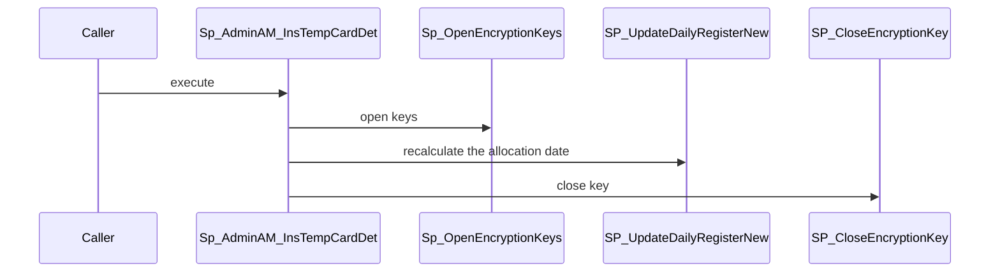
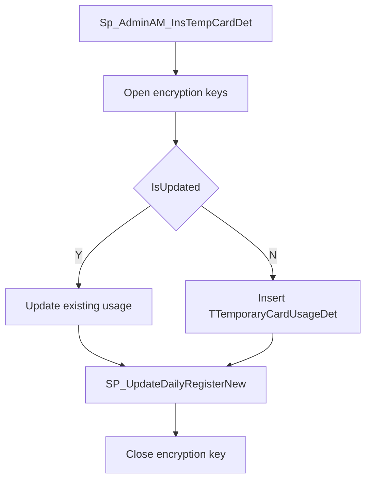

# Sp_AdminAM_InsTempCardDet

## What it does

Allocates a temporary access card to an employee, or updates an existing allocation when `@IsUpdated` is `Y`. After the write it recalculates that employee's daily attendance for the allocation date. On an update it also recalculates the previous holder and date.

## Parameters

| Name | Direction | What it is for |
|---|---|---|
| `@EmployeeId` | in | Employee who receives the card |
| `@CardId` | in | Temporary card |
| `@AllocationDate` | in | Day the allocation starts |
| `@CreatedBy` | in | Administrator |
| `@Comments` | in | Note |
| `@IsUpdated` | in | `N` insert, `Y` update |
| `@CardUsageId` | in | Existing usage id when updating |
| `@AccessCardReason` | in | Reason lookup |

## Call sequence

## Callers

No other procedure or function calls this object. `AttendanceManagementDAL.SaveTemporaryCardDetails` calls it from Attendance Management.

## Nested

| Object | Kind | When | Page |
|---|---|---|---|
| `Sp_OpenEncryptionKeys` | procedure | before the write | [Sp_OpenEncryptionKeys](/docs/database/hrms/Sp_OpenEncryptionKeys) |
| `SP_UpdateDailyRegisterNew` | procedure | after insert, and for the previous employee on update | [SP_UpdateDailyRegisterNew](/docs/database/hrms/SP_UpdateDailyRegisterNew) |
| `SP_CloseEncryptionKey` | procedure | at the end | [SP_CloseEncryptionKey](/docs/database/hrms/SP_CloseEncryptionKey) |

## Steps

1. `EXEC Sp_OpenEncryptionKeys`.
2. When `@IsUpdated = 'Y'`, remember the previous employee and date, then update the usage row.
3. Otherwise insert `TTemporaryCardUsageDet`.
4. `EXEC SP_UpdateDailyRegisterNew` for the affected employee and date. Source is `TemporaryCardMapping` or `UpdateTemporaryCardMapping`.
5. `EXEC SP_CloseEncryptionKey`.

## Tables

| Table | Read or write |
|---|---|
| `TTemporaryCardUsageDet` | write |

## Flow

