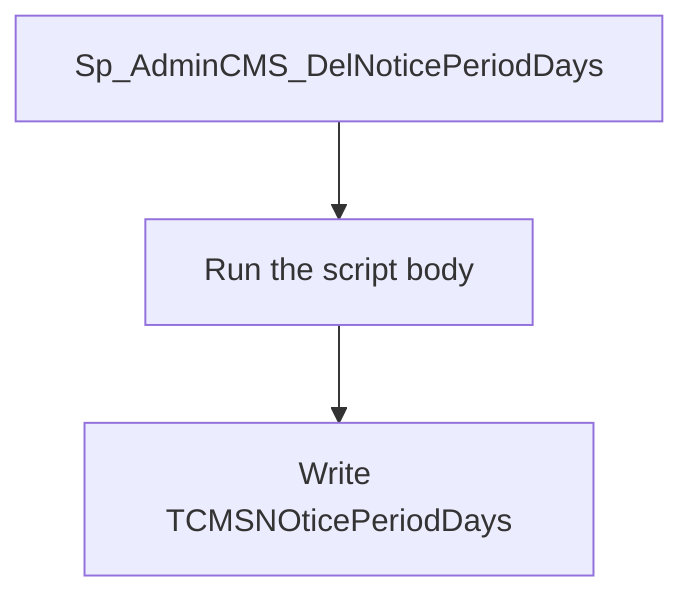

# Sp_AdminCMS_DelNoticePeriodDays

## What it does

Deletes one probation-extension day-count row.

## Parameters

| Name | Direction | What it is for |
|---|---|---|
| `@TransID` | in | Trans ID |

## Call sequence

Calls no other procedures or functions.

## Callers

No other procedure or function calls this object.

## Nested

Calls no other procedures or functions.

## Steps

Script: `HRMS-DATABASE/HRMS/STOREPROCEDURE/Sp_AdminCMS_DelNoticePeriodDays.sql`.

1. Delete From TCMSNOticePeriodDays Where TransID=@TransID

## Tables

| Table | Read or write |
|---|---|
| `TCMSNOticePeriodDays` | read/write |

## Flow

