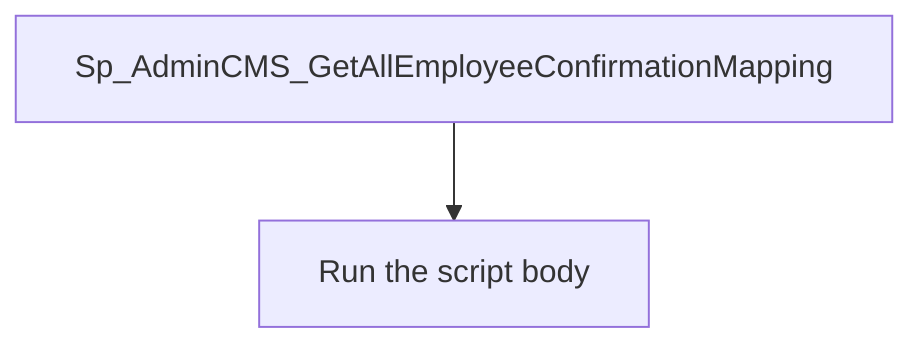

# Sp_AdminCMS_GetAllEmployeeConfirmationMapping

## What it does

Lists confirmation form mappings for an employer, with the form, score method, rating scale, and the designations, roles, and business units each mapping covers.

## Parameters

| Name | Direction | What it is for |
|---|---|---|
| `@EmployerId` | in | Employer Id |

## Call sequence

Calls no other procedures or functions.

## Callers

No other procedure or function calls this object.

## Nested

Calls no other procedures or functions.

## Steps

Script: `HRMS-DATABASE/HRMS/STOREPROCEDURE/Sp_AdminCMS_GetAllEmployeeConfirmationMapping.sql`.

1. SELECT DISTINCT CategoryId,CategoryName,Designations,Roles,BusinessUnit,ScoreMethod,ScoreMethodType,RatingScaleId,RatingScale,ConfirmationMappingId from (
2. SELECT cm.CategoryId
3. SELECT DISTINCT stuff((
4. SELECT ', ' + [Title]
5. SELECT t.Title
6. SELECT MD.DesignationId
7. SELECT DISTINCT stuff((
8. SELECT ', ' + [EmployeeRoleName]
9. SELECT t.EmployeeRoleName
10. SELECT MD.RoleId
11. SELECT DISTINCT stuff((
12. SELECT ', ' + [UnitName]

## Tables

| Table | Read or write |
|---|---|
| `TTitle` | read |
| `TCMSEmployeeConfirmationForDesignation` | read |
| `TEmployeeRoleMaster` | read |
| `TCMSEmployeeConfirmationForRole` | read |
| `TOrgHierarchyDetails` | read |
| `TCMSEmployeeConfirmationForBU` | read |
| `TPMSRatingMaster` | read |
| `TPMSGOALCATEGORY` | read |
| `TPMSGOALCATEGORYDETAILS` | read |
| `TPMSWeightageMaster` | read |
| `TCMSEmployeeConfirmationMapping` | read |

## Flow

