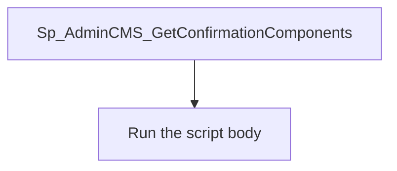

# Sp_AdminCMS_GetConfirmationComponents

## What it does

Lists additional confirmation-form components for one employer, including who each component applies to, who can view it, and which forms it is attached to.

## Parameters

| Name | Direction | What it is for |
|---|---|---|
| `@Employerid` | in | Employerid |

## Call sequence

Calls no other procedures or functions.

## Callers

No other procedure or function calls this object.

## Nested

Calls no other procedures or functions.

## Steps

Script: `HRMS-DATABASE/HRMS/STOREPROCEDURE/Sp_AdminCMS_GetConfirmationComponents.sql`.

1. Select ComponentId,
2. SELECT ',' + Convert(varchar(500),ss.ReviewLevel )
3. SELECT ',' + Convert(varchar(500),c.CategoryName )
4. SELECT ',' + Convert(varchar(500),ss.CategoryId )

## Tables

| Table | Read or write |
|---|---|
| `TCMS_ConfirmationComponentPermissions` | read |
| `TCMS_ViewConfirmationComponentPermissions` | read |
| `TCMSConfirmationComponentCategorys` | read |
| `TCMSConfirmationComponents` | read |

## Flow

