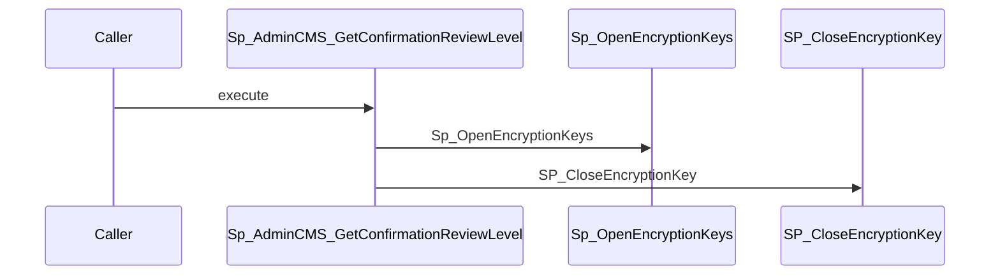
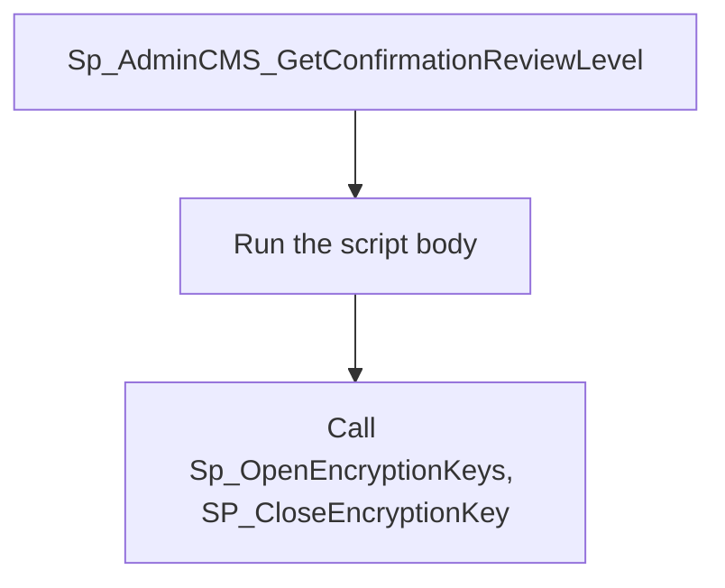

# Sp_AdminCMS_GetConfirmationReviewLevel

## What it does

Returns the confirmation workflow's review levels for an employer, used when configuration decides which levels must comment or rate.

## Parameters

| Name | Direction | What it is for |
|---|---|---|
| `@EmployerId` | in | Employer Id |

## Call sequence

## Callers

| Object | Kind | Page |
|---|---|---|
| `SP_CMS_GetCompetencyforConfirmation` | procedure | No page yet |
| `SP_CMS_GetConfirmationDetailsforExtract` | procedure | No page yet |

## Nested

| Object | Kind | When | Page |
|---|---|---|---|
| `Sp_OpenEncryptionKeys` | procedure | during execution | [Sp_OpenEncryptionKeys](/docs/database/hrms/Sp_OpenEncryptionKeys) |
| `SP_CloseEncryptionKey` | procedure | during execution | [SP_CloseEncryptionKey](/docs/database/hrms/SP_CloseEncryptionKey) |

## Steps

Script: `HRMS-DATABASE/HRMS/STOREPROCEDURE/Sp_AdminCMS_GetConfirmationReviewLevel.sql`.

1. EXEC Sp_OpenEncryptionKeys
2. SELECT top 1 WM.WorkflowId
3. SELECT @XMLString = CAST(REPLACE(WorkflowDefinitionTree, '<?xml version="1.0" encoding="utf-16"?>', '') AS XML)
4. INSERT INTO @TableName (
5. SELECT Node.value('(Node/@Text[1])[1]', 'VARCHAR(500)') AS P1
6. SELECT CASE WHEN IsConfSelfAssesmentRequired = 1 THEN 'Employee' ELSE '' END columnname, 0 Approvallevel
7. SELECT DISTINCT CASE
8. ELSE columnname
9. select case when t.columnname='Employee' then 1
10. else 6
11. EXEC SP_CloseEncryptionKey

## Tables

| Table | Read or write |
|---|---|
| `TWorkflowManagement` | read |
| `TWorkFlowBusinessUnits` | read |
| `TWorkFlowLocations` | read |
| `TPMSEmployerConfiguration` | read |

## Flow

