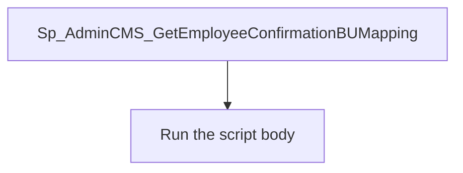

# Sp_AdminCMS_GetEmployeeConfirmationBUMapping

## What it does

Returns the business units attached to one confirmation mapping.

## Parameters

| Name | Direction | What it is for |
|---|---|---|
| `@ConfirmationMappingId` | in | Confirmation Mapping Id |
| `@EmployerId` | in | Employer Id |

## Call sequence

Calls no other procedures or functions.

## Callers

No other procedure or function calls this object.

## Nested

Calls no other procedures or functions.

## Steps

Script: `HRMS-DATABASE/HRMS/STOREPROCEDURE/Sp_AdminCMS_GetEmployeeConfirmationBUMapping.sql`.

1. Select cd.CategoryId,

## Tables

| Table | Read or write |
|---|---|
| `TOrgHierarchyDetails` | read |
| `TCMSEmployeeConfirmationMapping` | read |
| `TCMSEmployeeConfirmationForBU` | read |

## Flow

