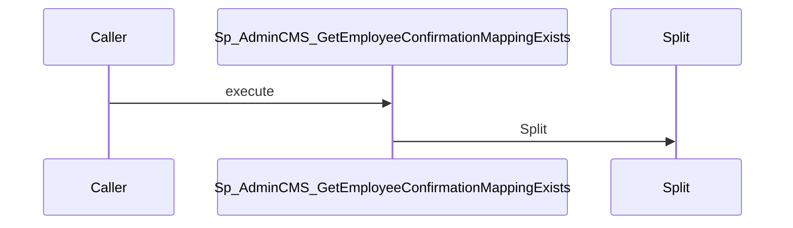
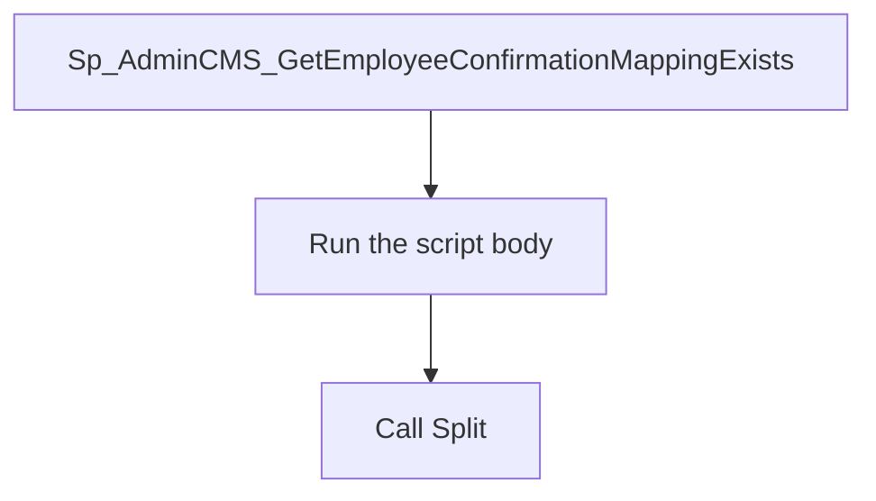

# Sp_AdminCMS_GetEmployeeConfirmationMappingExists

## What it does

Checks whether a category plus designation, role, or business unit is already mapped for an employer.

## Parameters

| Name | Direction | What it is for |
|---|---|---|
| `@CategoryId` | in | Category Id |
| `@EmployerId` | in | Employer Id |
| `@DesignationId` | in | Designation Id |
| `@RoleId` | in | Role Id |
| `@BusinessUnitId` | in | Business Unit Id |

## Call sequence

## Callers

No other procedure or function calls this object.

## Nested

| Object | Kind | When | Page |
|---|---|---|---|
| `Split` | function | during execution | [Split](/docs/database/hrms/Split) |

## Steps

Script: `HRMS-DATABASE/HRMS/STOREPROCEDURE/Sp_AdminCMS_GetEmployeeConfirmationMappingExists.sql`.

1. if(len(ltrim(@RoleId)) =0) set @RoleId =null
2. if(len(ltrim(@DesignationId)) =0) set @DesignationId =null
3. if(len(ltrim(@BusinessUnitId)) =0) set @BusinessUnitId =null
4. If @tempMappingCount = 0
5. SELECT 0 as IsRecordExist
6. SELECT 1 as IsRecordExist

## Tables

| Table | Read or write |
|---|---|
| `TCMSEmployeeConfirmationMapping` | read |
| `tcmsemployeeconfirmation` | read |
| `TCMSEmployeeConfirmationForBU` | read |
| `TCMSEmployeeConfirmationForRole` | read |
| `TCMSEmployeeConfirmationForDesignation` | read |

## Flow

