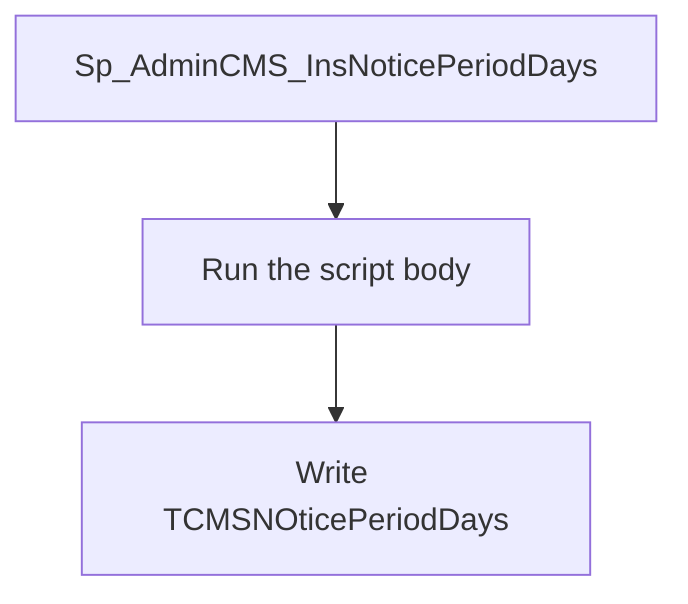

# Sp_AdminCMS_InsNoticePeriodDays

## What it does

Inserts a probation-extension day count for an employer when that count is not already stored.

## Parameters

| Name | Direction | What it is for |
|---|---|---|
| `@NumberOfDays` | in | Number Of Days |
| `@EmployerId` | in | Employer Id |
| `@CreatedBy` | in | Created By |
| `@IsActive` | in | Is Active |

## Call sequence

Calls no other procedures or functions.

## Callers

No other procedure or function calls this object.

## Nested

Calls no other procedures or functions.

## Steps

Script: `HRMS-DATABASE/HRMS/STOREPROCEDURE/Sp_AdminCMS_InsNoticePeriodDays.sql`.

1. If (Select Count(1) From TCMSNOticePeriodDays Where EmployerId=@EmployerId And Upper(NumberOfDays)=Upper(@NumberOfDays)) >0
2. Select 1 ErrorCode
3. Insert Into TCMSNOticePeriodDays(NumberOfDays,EmployerId,isactive,CreatedBy,CreatedDate)
4. Select 0 ErrorCode

## Tables

| Table | Read or write |
|---|---|
| `TCMSNOticePeriodDays` | read/write |

## Flow

