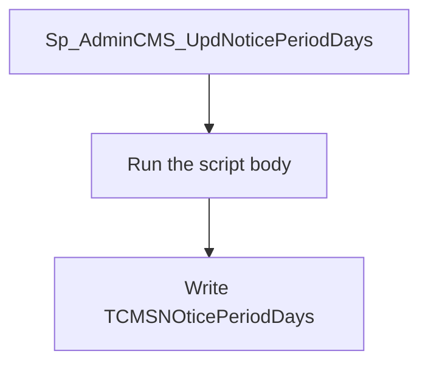

# Sp_AdminCMS_UpdNoticePeriodDays

## What it does

Updates one probation-extension day count and its active flag.

## Parameters

| Name | Direction | What it is for |
|---|---|---|
| `@TransID` | in | Trans ID |
| `@NumberOfDays` | in | Number Of Days |
| `@IsActive` | in | Is Active |
| `@ModifiedBy` | in | Modified By |
| `@Employerid` | in | Employerid |

## Call sequence

Calls no other procedures or functions.

## Callers

No other procedure or function calls this object.

## Nested

Calls no other procedures or functions.

## Steps

Script: `HRMS-DATABASE/HRMS/STOREPROCEDURE/Sp_AdminCMS_UpdNoticePeriodDays.sql`.

1. If (Select Count(1) From TCMSNOticePeriodDays Where EmployerId=@EmployerId And Upper(NumberOfDays)=Upper(@NumberOfDays)And TransID<>@TransID) >0
2. Select 1 ErrorCode
3. Update TCMSNOticePeriodDays
4. Select 0 ErrorCode

## Tables

| Table | Read or write |
|---|---|
| `TCMSNOticePeriodDays` | read/write |

## Flow

