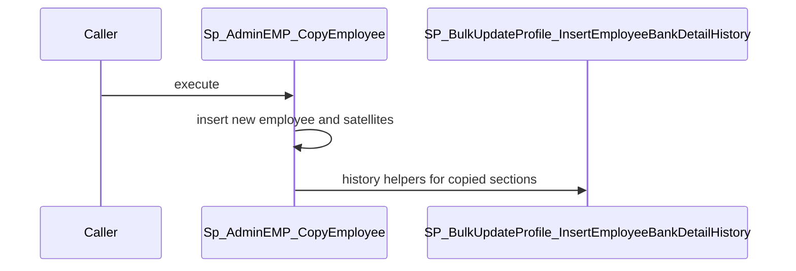
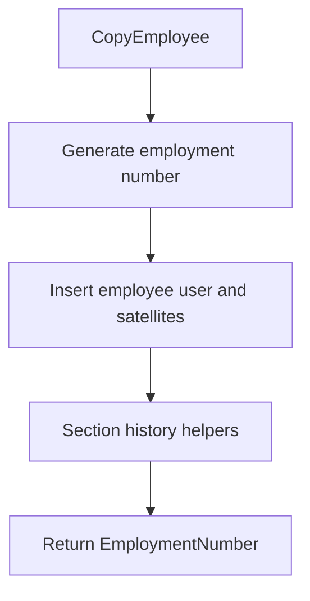

# Sp_AdminEMP_CopyEmployee

## What it does

Clones an employee into a new employee (and related login) with a generated employment number and default password payload. Copies personal/official/satellite profile data (bank, visa, family, nomination, education, skills, etc.), writes history helpers, and returns the new employment number (or a duplicate-number status).

## Parameters

| Name | Direction | What it is for |
|---|---|---|
| `@Employeeid` | in | Source employee to copy |
| `@CreatedBy` | in | Acting employee |
| `@Password` | in | Encrypted default password for the new user |

## Call sequence

## Callers

Application caller: Search Employee copy operation → `POST /api/employees/{id}/copy` → `copyEmployee.js`.

## Nested

| Object | Kind | When | Page |
|---|---|---|---|
| `SP_BulkUpdateProfile_InsertEmployeeBankDetailHistory` | procedure | after bank copy | skipped this pass |
| `SP_BulkUpdateProfile_InsertEmployeeVisaHistory` | procedure | after visa copy | skipped this pass |
| `SP_BulkUpdateProfile_InsertEmployeeEmergencyContactDetailHistory` | procedure | after emergency copy | skipped this pass |
| `SP_BulkUpdateProfile_InsertEmployeeFamilyHistory` | procedure | after family copy | skipped this pass |
| `SP_BulkUpdateProfile_InsertEmployeeNominationHistory` | procedure | after nomination copy | skipped this pass |
| `SP_BulkUpdateProfile_InsertEmployeeNomineeHistory` | procedure | after nominee copy | skipped this pass |
| `SP_BulkUpdateProfile_InsertEmployeeEducationHistory` | procedure | after education copy | skipped this pass |
| `SP_BulkUpdateProfile_InsertEmployeeCertificationHistory` | procedure | after certification copy | skipped this pass |
| `SP_BulkUpdateProfile_InsertEmployeeSkillHistory` | procedure | after skill copy | skipped this pass |
| `SP_BulkUpdateProfile_InsertEmployeeDomainHistory` | procedure | after domain copy | skipped this pass |
| `SP_BulkUpdateProfile_InsertEmployeePastEmploymentHistory` | procedure | after past employment copy | skipped this pass |

Encryption open/close helpers are infrastructure only.

## Steps

1. Script is `HRMS-DATABASE/HRMS/STOREPROCEDURE/Sp_AdminEMP_CopyEmployee.sql`.
2. Open encryption keys; read source employee employer / employment type / name / DOB.
3. Generate the next employment number from employer/type sequencing rules.
4. Insert new `TEmployee` / `TEmployeeInfo` / user link and copy satellite tables.
5. Call section history insert procedures; return new employment number / status.

## Tables

| Table | Read or write |
|---|---|
| `dbo.TEmployee` / `TEmployeeInfo` | read and write |
| `dbo.TUsers` / `TUserEmployee` | write |
| `dbo.TMEmploymentTypes` / `TEmployerDetails` | read |
| Multiple `TEmployee*` satellite tables | read and write |

## Flow

