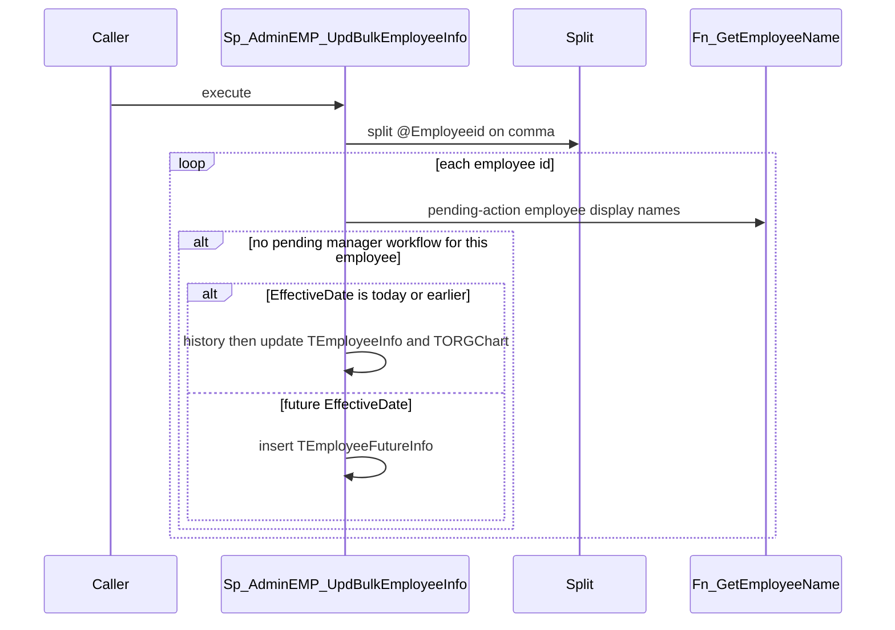
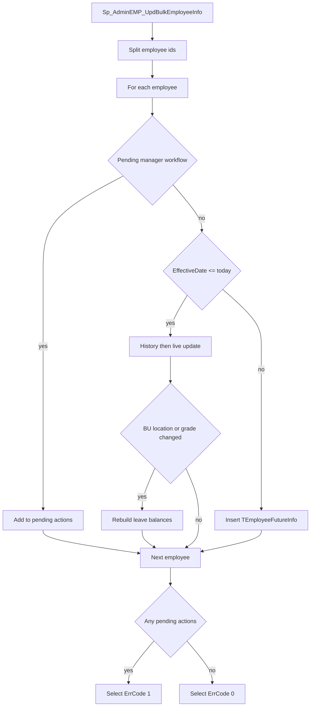

# Sp_AdminEMP_UpdBulkEmployeeInfo

## What it does

Applies the same official-information changes to a comma-separated list of employee ids for one employer. For each employee it first looks for pending confirmation, goal-setting, or self-assessment workflow rows that still involve the current or newly supplied reporting / functional manager. When any such pending action exists for an employee, that employee is skipped for update and the procedure returns `ErrCode` `1` with a typed error message if any pending rows were collected. Otherwise, when `@EffectiveDate` is today or earlier it snapshots `TEmployeeInfo` / `TORGChart` into history tables and updates live rows for the supplied non-null fields; when the date is in the future it inserts `TEmployeeFutureInfo`. Business unit, location, or grade changes on an immediate update can rebuild leave-balance rows for the employee.

## Parameters

| Name | Direction | What it is for |
|---|---|---|
| `@Employerid` | in | Employer of the employees being updated |
| `@Employeeid` | in | Comma-separated employee ids |
| `@EffectiveDate` | in | Effective date for the change (immediate vs future path) |
| `@BusinessUnit` | in | New business unit id, or null to leave unchanged |
| `@titleid` | in | New designation / title id, or null |
| `@locationid` | in | New location id, or null |
| `@shifttype` | in | New shift id, or null |
| `@ReportingManager` | in | New reports-to employee id, or null |
| `@FunctionalManager` | in | New functional manager employee id, or null |
| `@ModifiedBy` | in | Employee id recorded as modifier |
| `@Grade` | in | New grade id, or null |
| `@Calendarid` | in | New calendar id, or null |

## Call sequence

## Callers

No other procedure or function calls this object. `EmployeeDal.UpdateBulkEmployeeDetails` executes it from Employee Bulk Update (`EmployeeBulkUpdate.aspx.cs`).

## Nested

| Object | Kind | When | Page |
|---|---|---|---|
| `Split` | function | split `@Employeeid` into the employee table variable | [Split](/docs/database/hrms/Split) |
| `Fn_GetEmployeeName` | function | build pending-action employee names | [Fn_GetEmployeeName](/docs/database/hrms/Fn_GetEmployeeName) |

## Steps

From `HRMS-DATABASE/HRMS/STOREPROCEDURE/Sp_AdminEMP_UpdBulkEmployeeInfo.sql`:

1. Insert split employee ids from `@Employeeid` into `@lv_Employee` via `dbo.Split`.
2. Cursor over each employee id. When reporting or functional manager inputs are non-zero, collect pending self-assessment, employee goal-setting, and confirmation workflow rows that still reference those managers into `@lv_PendingActions` (using `Fn_GetEmployeeName` for display names).
3. When the employee has no pending-action row, branch on `@EffectiveDate` versus today.
4. Immediate path: insert `TEmployeeInfoHistory` and `TORGChartHistory`, then conditionally update `TEmployeeInfo` fields and `TORGChart.ReportsTo`. When business unit, location, or grade changed, archive unmatched leave balances and insert new `tLeaveBalance` / `TLeaveBalanceLedger` rows filtered by grade, BU, location, employment type, gender, and calendar.
5. Future path: insert one `TEmployeeFutureInfo` row merging current info with non-null parameter overrides, including contract end date from `TEmployeeEmploymentType`.
6. After the cursor, if any pending actions were collected, select `ErrCode` `1` and a confirmation / goal / self-assessment message; otherwise select `ErrCode` `0` and an empty `ErrorMessage`.
7. On catch, select `ErrCode` `1` and a generic execution error message, then return.

## Tables

| Table | Read or write |
|---|---|
| `dbo.TRequestWorkflows` | read |
| `dbo.TPMSEmployeeSelfAppraisal` | read |
| `dbo.TPMSAPPRAISALCYCLES` | read |
| `dbo.TPMSEmployeeGoalSetting` | read |
| `dbo.TPMSEmployeeGoalMapping` | read |
| `dbo.TPMS_GoalSettingReviewFrequency` | read |
| `dbo.TCMSEmployeeConfirmation` | read |
| `dbo.TEmployee` | read |
| `dbo.TEmployeeInfo` | read, write |
| `dbo.TEmployeeInfoHistory` | write |
| `dbo.TORGChart` | read, write |
| `dbo.TORGChartHistory` | write |
| `dbo.TEmployeeFutureInfo` | write |
| `dbo.TEmployeeEmploymentType` | read |
| `dbo.TGrade` | read |
| `dbo.TEmployerDetails` | read |
| `dbo.tLeaveBalance` | read, write |
| `dbo.TLeaveBalanceHistory` | write |
| `dbo.TLeaveBalanceLedger` | write |
| `dbo.TLeaveTypeMaster` | read |
| `dbo.TLeaveBusinessUnit` | read |
| `dbo.TLeaveGrade` | read |
| `dbo.TLeaveLocation` | read |
| `dbo.TLeaveEmployeeStatus` | read |
| `dbo.tLeaveCalendar` | read |

## Flow

