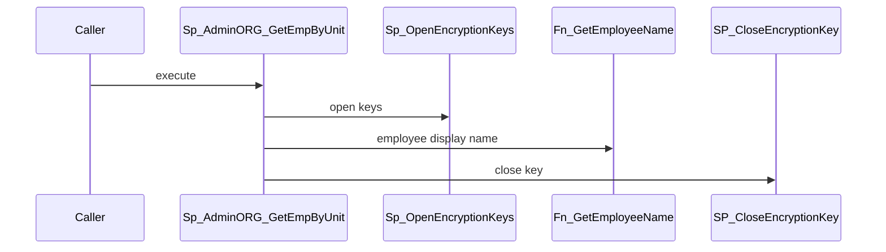
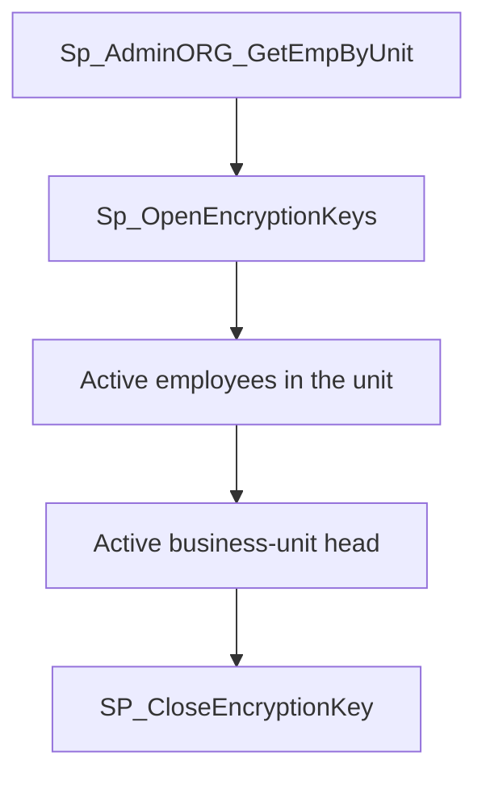

# Sp_AdminORG_GetEmpByUnit

## What it does

Returns two result sets for one business unit. The first is active employees in that unit, ordered by employment number. The second is the active business-unit head for that unit and employer, with a display string of name, employment number, and employer name. The header credits the second result set to work item 76745.

## Parameters

| Name | Direction | What it is for |
|---|---|---|
| `@UnitId` | in | `TEmployeeInfo.BusinessUnitId` and `TEmployeeOrgBusinessHead.BusinessUnitId` to match. Declared as `INT` |
| `@Employerid` | in | Employer on the employee and on the head row |

## Call sequence

## Callers

No other procedure or function calls this object. Create Organization Structure calls it through `EmployerDal.GetEmployeeListByOrg` when a tree node is selected and when the grid asks for data.

## Nested

| Object | Kind | When | Page |
|---|---|---|---|
| `Sp_OpenEncryptionKeys` | procedure | start of the procedure | [Sp_OpenEncryptionKeys](/docs/database/hrms/Sp_OpenEncryptionKeys) |
| `Fn_GetEmployeeName` | function | each employee row, and the head display string | [Fn_GetEmployeeName](/docs/database/hrms/Fn_GetEmployeeName) |
| `SP_CloseEncryptionKey` | procedure | after both result sets | [SP_CloseEncryptionKey](/docs/database/hrms/SP_CloseEncryptionKey) |

## Steps

In `HRMS-DATABASE/HRMS/STOREPROCEDURE/Sp_AdminORG_GetEmpByUnit.sql`:

1. Execute [Sp_OpenEncryptionKeys](/docs/database/hrms/Sp_OpenEncryptionKeys).
2. Select `Employeeid`, `EmploymentNumber`, and [Fn_GetEmployeeName](/docs/database/hrms/Fn_GetEmployeeName) from `Temployeeinfo` and `TEmployee` where `BusinessUnitId` is `@UnitId`, the employee is active, and `TEmployee.Employerid` is `@Employerid`. Order by `EmploymentNumber`.
3. Select the active `TEmployeeOrgBusinessHead` row for `@Employerid` and `@UnitId`. The display column concatenates the employee name, employment number, and `TEmployerDetails.EmployerName`.
4. Execute [SP_CloseEncryptionKey](/docs/database/hrms/SP_CloseEncryptionKey).

## Tables

| Table | Read or write |
|---|---|
| `dbo.Temployeeinfo` | read |
| `dbo.TEmployee` | read |
| `dbo.TEmployeeOrgBusinessHead` | read |
| `dbo.TEmployerDetails` | read |

## Flow

