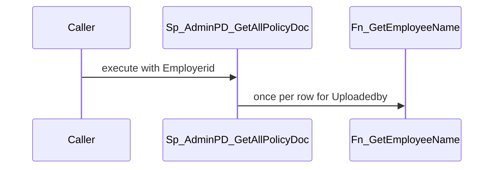
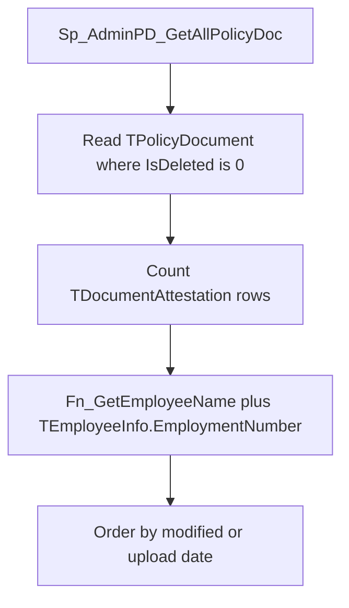

# Sp_AdminPD_GetAllPolicyDoc

## What it does

Returns the policy grid for one employer. Deleted rows are omitted. Each row includes the attestation count, the uploader's display name and employment number, and the sign-off and enforcement fields the grid shows. The header comment says this gets all policy document details.

`PolicyDocDAL.GetPolicyDocuments` calls this from Policy Documents Setup for the grid, the rebind, and the name-and-version check.

## Parameters

| Name | Direction | What it is for |
|---|---|---|
| `@Employerid` | in | Employer whose policies are listed. |

## Call sequence

## Callers

No other procedure or function calls this object. `PolicyDocDAL.GetPolicyDocuments` executes it from Policy Documents Setup.

## Nested

| Object | Kind | When | Page |
|---|---|---|---|
| `Fn_GetEmployeeName` | function | each returned row, display name of `Uploadedby` | [Fn_GetEmployeeName](/docs/database/hrms/Fn_GetEmployeeName) |

## Steps

1. In `HRMS-DATABASE/HRMS/STOREPROCEDURE/Sp_AdminPD_GetAllPolicyDoc.sql`, select from `TPolicyDocument` where `Employerid` is `@Employerid` and `IsDeleted` is 0.
2. `IsActive` becomes `Active` or `Inactive`. `IsReminderNotification` becomes `Y` or `N`. `IsAllowDownload` becomes `Enable` or `Disable`. `IsEnableSignOff` becomes `Y` or `N` in column `EnableSignOff`.
3. `AttestationCount` is `count(1)` from `TDocumentAttestation` for that `DocumentId`. The count does not require `AttestationDate`.
4. `SubmittedBy` is `dbo.Fn_GetEmployeeName(Uploadedby)` plus the `EmploymentNumber` from `TEmployeeInfo` for that employee. The employment-number subquery is scalar. More than one `TEmployeeInfo` row for that employee fails the statement. A null name or a null employment number makes the whole `SubmittedBy` expression null.
5. Also return `DocumentId`, `DocumentName`, `DocumentDescription`, `Versionnumber`, `DocumentPath`, `Uploadedby`, `UploadDate`, `RepeatFor`, `SignOffWithIn`, `InactiveReason`, `ActivationDate` as `PolicyActivatedOn`, `UploadDate` as `PolicyCreatedOn` and `SubmittedOn`, and `EnforcementMode`.
6. Order by `ISNULL(ModifiedDate, UploadDate)` descending, then `DocumentName`, then `Versionnumber`.

## Tables

| Table | Read or write |
|---|---|
| `dbo.TPolicyDocument` | read |
| `dbo.TDocumentAttestation` | read |
| `dbo.TEmployeeInfo` | read |

`Fn_GetEmployeeName` reads the employee name tables. Those reads are on that function's page.

## Flow

