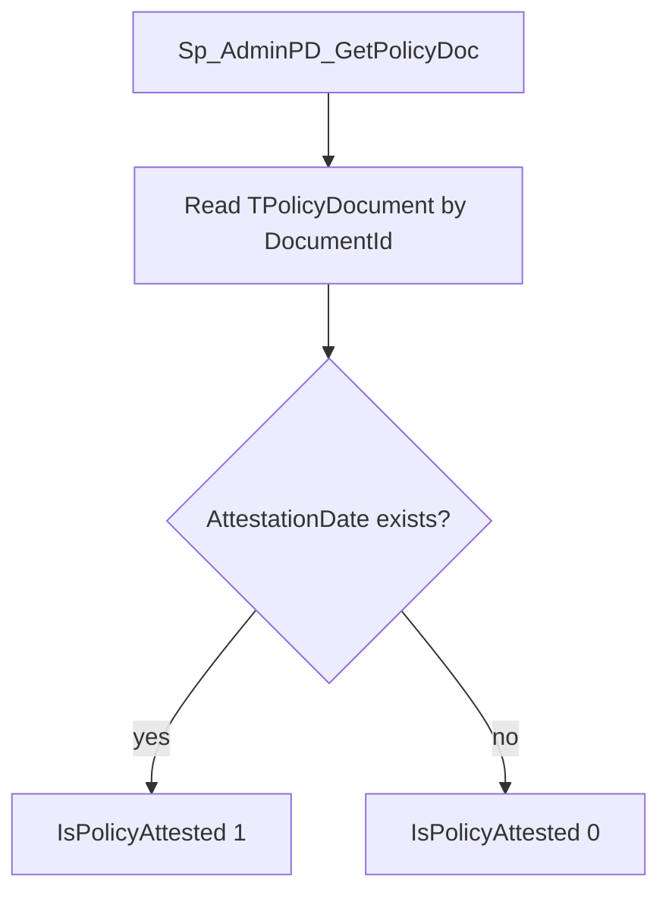

# Sp_AdminPD_GetPolicyDoc

## What it does

Returns one policy document for the edit form. `IsActive` is `Y` or `N`. Download is `Enable` or `Disable`. `AcknStatement` is returned as `AcknowledgementStatement`. `IsPolicyAttested` is 1 when any attestation row for that document has an attestation date. The header comment says this gets all policy document details. The statement reads one id.

`PolicyDocDAL.GetPolicyDocumentDetails` calls this from Policy Documents Setup.

## Parameters

| Name | Direction | What it is for |
|---|---|---|
| `@DocumentId` | in | Policy to load. |

## Call sequence

Calls no other procedures or functions.

## Callers

No other procedure or function calls this object. `PolicyDocDAL.GetPolicyDocumentDetails` executes it from Policy Documents Setup.

## Nested

Calls no other procedures or functions.

## Steps

1. In `HRMS-DATABASE/HRMS/STOREPROCEDURE/Sp_AdminPD_GetPolicyDoc.sql`, select the `TPolicyDocument` row whose `DocumentId` is `@DocumentId`. There is no `IsDeleted` filter and no employer filter.
2. Map `IsActive` to `Y` or `N`, and `IsAllowDownload` to `Enable` or `Disable`.
3. Return `IsEnableSignOff` as `EnableSignOff`, `IsNotApplicableAllowed` as `NotApplicableAllowed`, and `AcknStatement` as `AcknowledgementStatement`.
4. Also return the description, version, path, uploader, upload date, reminder columns, inactive reason, sign-off days, the four exclusion id lists, and `EnforcementMode`.
5. Set `IsPolicyAttested` to 1 when `TDocumentAttestation` has a row for `@DocumentId` with `AttestationDate` not null. Otherwise set it to 0.

The list procedure's attestation count does not require a date. This flag does.

## Tables

| Table | Read or write |
|---|---|
| `dbo.TPolicyDocument` | read |
| `dbo.TDocumentAttestation` | read |

## Flow

