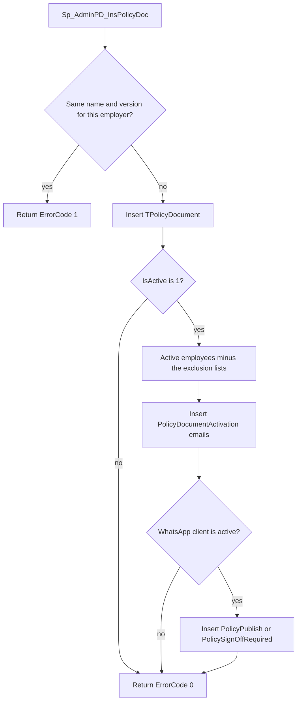

# Sp_AdminPD_InsPolicyDoc

## What it does

Inserts one policy document for an employer, or refuses the insert when that employer already has the same document name and version. A new active policy also queues an activation email for each covered active employee, and queues a WhatsApp row when that employer has an active WhatsApp client. The header comment says the procedure gets policy document details. The statements insert. The sample `EXEC` in the header is inside the comment block.

`PolicyDocDAL.InsertPolicyDocument` calls this from Policy Documents Setup. The page treats `ErrorCode` `0` as success.

## Parameters

| Name | Direction | What it is for |
|---|---|---|
| `@DocumentName` | in | Policy name, `varchar(500)`. |
| `@DocumentDescription` | in | Description, `varchar(1000)`. |
| `@Versionnumber` | in | Version, `decimal(8, 2)`. |
| `@IsActive` | in | `1` stores an activation date and queues notifications. |
| `@DocumentPath` | in | File path stored on the row, `varchar(1000)`. |
| `@Employerid` | in | Employer the policy belongs to. |
| `@ActivatedBy` | in | Employee stored as `ActivatedBy` only when `@IsActive` is 1. |
| `@Uploadedby` | in | Employee stored as `Uploadedby`. |
| `@IsReminderNotification` | in | Reminder flag. |
| `@StartDate` | in | Reminder start. Also stored as `NextRunDate`. |
| `@RepeatForEvery` | in | Numeric repeat interval. The commented next-run calculation used this. |
| `@RepeatFor` | in | Cadence text, `varchar(100)`. |
| `@EndDate` | in | Reminder end date. |
| `@IsAllowDownload` | in | Download allowed. |
| `@IsEnableSignOff` | in | Sign-off required. Default `0`. |
| `@InactiveReason` | in | Inactive reason, `varchar(1000)`. |
| `@SignOffWithIn` | in | Sign-off day count. |
| `@IsNotApplicableAllowed` | in | Exclusion flag. Default `0`. |
| `@EmploymentTypeIDs` | in | Comma-separated employment type ids to exclude. Default null. |
| `@BusinessUnitIDs` | in | Comma-separated business unit ids to exclude. Default null. |
| `@GradeIDs` | in | Comma-separated grade ids to exclude. Default null. |
| `@DesignationIDs` | in | Comma-separated designation ids to exclude. Default null. |
| `@EnforcementMode` | in | `MANDATORY`, `REMINDER`, or `NONE`. Default null. |
| `@AcknStatement` | in | Acknowledgement text. Default null. |

## Call sequence

Calls no other procedures or functions. `STRING_SPLIT` and `GETDATE` are built-ins. The duplicate check and the employee filter are inline SQL.

## Callers

No other procedure or function calls this object. `PolicyDocDAL.InsertPolicyDocument` executes it from Policy Documents Setup.

## Nested

Calls no other procedures or functions.

## Steps

1. In `HRMS-DATABASE/HRMS/STOREPROCEDURE/Sp_AdminPD_InsPolicyDoc.sql`, count `TPolicyDocument` rows for the same employer whose name matches `@DocumentName` case-insensitively and whose `Versionnumber` equals `@Versionnumber`. The count does not filter `IsDeleted`.
2. When that count is greater than 0, return `ErrorCode` 1 and insert nothing.
3. Otherwise, when `@IsActive` is 1, set the activation date to `GETDATE()` and `@Lv_ActivatedBy` to `@ActivatedBy`. When it is 0, both are null.
4. Insert one `TPolicyDocument` row. `UploadDate` is `GETDATE()`. `NextRunDate` is `@StartDate`. The older `DATEADD` next-run block is commented out. `EnforcementMode` is `ISNULL(@EnforcementMode, 'REMINDER')` when `@IsEnableSignOff` is 1, and null otherwise.
5. When `@IsActive` is 1, take `SCOPE_IDENTITY()` as `@DocumentId` and fill `#Employees` with active `TEmployee` rows for `@Employerid`. `TEmployeeInfo` is joined on `EmployeeId`. A non-null exclusion list drops employees whose `EmploymentTypeID`, `BusinessUnitId`, `Grade`, or `DesignationId` is in that list.
6. Insert one pending `TEmailNotification` row per employee in `#Employees`. `TemplateName` is `PolicyDocumentActivation`, `TransId` is `@DocumentId`, `ActionName` is `Notification`, `Status` is `Pending`, `WfId` and `MultiId` are null, and `RequestOwnerEmployeeID` is that employee.
7. When `[MSG-MESH].dbo.MessagingClientConfig` has an active `WHATSAPP` row for `@Employerid`, insert one pending `TWhatsAppNotification` per employee. `Module` is `PolicyPublish` when sign-off is off and `PolicySignOffRequired` when sign-off is on. `CreatedBy` is the employee id.
8. Return `ErrorCode` 0.

`CK_TPolicyDocument_EnforcementMode` allows only null, `MANDATORY`, `REMINDER`, or `NONE`. The baseline `TABLES/TPolicyDocument.sql` does not declare the later columns this insert writes.

## Tables

| Table | Read or write |
|---|---|
| `dbo.TPolicyDocument` | read, write |
| `dbo.TEmployee` | read |
| `dbo.TEmployeeInfo` | read |
| `dbo.TEmailNotification` | write |
| `dbo.TWhatsAppNotification` | write |
| `[MSG-MESH].dbo.MessagingClientConfig` | read |

## Flow

