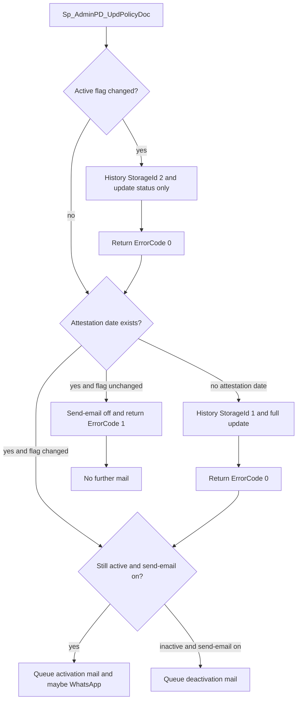

# Sp_AdminPD_UpdPolicyDoc

## What it does

Updates one policy document. A change of the active flag writes a history row and updates only the status fields. A content change is allowed only when no attestation row for that document has an attestation date. When the document stays active, or is switched to active, and the send-email flag stays on, the procedure queues activation mail for covered employees who do not already have one. Switching to inactive queues a deactivation mail instead. The header comment says the procedure gets policy document details. The statements update. The sample `EXEC` in the header is inside the comment block.

`PolicyDocDAL.UpdatePolicyDocument` calls this from Policy Documents Setup and treats the first result row's `ErrorCode` `0` as success.

## Parameters

| Name | Direction | What it is for |
|---|---|---|
| `@DocumentId` | in | Policy row to update. |
| `@DocumentName` | in | New name, `varchar(500)`. |
| `@DocumentDescription` | in | New description, `varchar(1000)`. |
| `@Versionnumber` | in | New version, `decimal(8, 2)`. |
| `@IsActive` | in | New active flag. |
| `@DocumentPath` | in | New file path, `varchar(1000)`. |
| `@Employerid` | in | Employer. The updates also filter on this value. Two later statements spell the same parameter `@EmployerId`. |
| `@ModifiedBy` | in | Employee stored as `ModifiedBy`, and as `ActivatedBy` on a full update. |
| `@IsReminderNotification` | in | Reminder flag. |
| `@StartDate` | in | Reminder start. Also stored as `NextRunDate` on a full update. |
| `@RepeatForEvery` | in | Numeric repeat interval. |
| `@RepeatFor` | in | Cadence text, `varchar(100)`. |
| `@EndDate` | in | Reminder end date. |
| `@IsAllowDownload` | in | Download allowed. |
| `@IsEnableSignOff` | in | Sign-off required. Default `0`. |
| `@InactiveReason` | in | Inactive reason, `varchar(1000)`. |
| `@SignOffWithIn` | in | Sign-off day count. |
| `@IsNotApplicableAllowed` | in | Exclusion flag. Default `0`. |
| `@EmploymentTypeIDs` | in | Comma-separated employment type ids to exclude. Default null. |
| `@BusinessUnitIDs` | in | Comma-separated business unit ids to exclude. Default null. |
| `@GradeIDs` | in | Comma-separated grade ids to exclude. Default null. |
| `@DesignationIDs` | in | Comma-separated designation ids to exclude. Default null. |
| `@EnforcementMode` | in | `MANDATORY`, `REMINDER`, or `NONE`. Default null. |
| `@AcknStatement` | in | Acknowledgement text. Default null. Written only on the full update. |

## Call sequence

Calls no other procedures or functions.

## Callers

No other procedure or function calls this object. `PolicyDocDAL.UpdatePolicyDocument` executes it from Policy Documents Setup.

## Nested

Calls no other procedures or functions.

## Steps

1. In `HRMS-DATABASE/HRMS/STOREPROCEDURE/Sp_AdminPD_UpdPolicyDoc.sql`, read `TPolicyDocument.IsActive` for `@DocumentId` into `@LV_IsActive`. `@LV_SendEmail` starts at 1.
2. When `@LV_IsActive` differs from `@IsActive`, copy the current row into `TPolicyDocument_History` with `StorageId` 2. `Action` is `Record Inactivated` when the row was active and is becoming inactive, `Record Activated` when it was inactive and is becoming active, and `Record Activated Or Inactivated` otherwise. The history column list does not include `AcknStatement`.
3. On that same status change, update only `IsActive`, `InactiveReason`, `ModifiedBy`, and `ModifiedDate`. Activating sets `InactiveReason` to null. Inactivating stores `@InactiveReason`. Return `ErrorCode` 0. This branch does not look at attestation.
4. Count `TDocumentAttestation` rows for `@DocumentId` whose `AttestationDate` is not null.
5. When that count is greater than 0 and the active flag did not change, set `@LV_SendEmail` to 0 and return `ErrorCode` 1. No columns are updated in this branch.
6. When that count is 0, copy the current row into `TPolicyDocument_History` with `StorageId` 1 and `Action` `Record Updated`, then update the live row's name, description, version, active flag, path, `ActivatedBy`, `ModifiedBy`, download, reminder fields, `NextRunDate` (`@StartDate`), sign-off, inactive reason, exclusion ids, and `AcknStatement`. `EnforcementMode` is `ISNULL(@EnforcementMode, 'REMINDER')` when sign-off is on, and null otherwise. `DeactivationDate` becomes `GETDATE()` when `@IsActive` is 0, and stays as it is otherwise. Return `ErrorCode` 0. This branch also runs when the flag changed and nobody has an attestation date, so the status-only update from step 3 is followed by this full update.
7. When `@IsActive` is 1 and `@LV_SendEmail` is still 1, build `#Employees` from active employees of the employer, minus the exclusion lists, minus employees who already have a `PolicyDocumentActivation` row for this `@DocumentId`. Insert a pending `PolicyDocumentActivation` email per remaining employee. When `[MSG-MESH].dbo.MessagingClientConfig` has an active `WHATSAPP` row for the employer, also insert `PolicyPublish` or `PolicySignOffRequired`.
8. When `@IsActive` is not 1 and `@LV_SendEmail` is still 1, do the same employee filter and skip anyone who already has a `PolicyDocumentDeactivated` row for this document. Insert those deactivation emails. This branch does not write `TWhatsAppNotification`.

A status change on an already attested policy stops at step 3 for the row update, still returns `ErrorCode` 0, and still reaches step 7 or 8 because `@LV_SendEmail` stays 1. The page reads the first result set, so it treats that as success.

## Tables

| Table | Read or write |
|---|---|
| `dbo.TPolicyDocument` | read, write |
| `dbo.TPolicyDocument_History` | write |
| `dbo.TDocumentAttestation` | read |
| `dbo.TEmployee` | read |
| `dbo.TEmployeeInfo` | read |
| `dbo.TEmailNotification` | read, write |
| `dbo.TWhatsAppNotification` | write |
| `[MSG-MESH].dbo.MessagingClientConfig` | read |

## Flow

