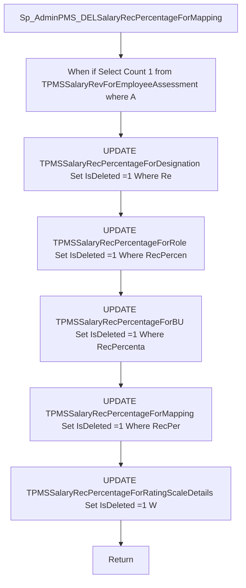

# Sp_AdminPMS_DELSalaryRecPercentageForMapping

## What it does

Stored procedure `Sp_AdminPMS_DELSalaryRecPercentageForMapping`. Writes `TPMSSalaryRecPercentageForDesignation`, `TPMSSalaryRecPercentageForRole`, `TPMSSalaryRecPercentageForBU`, `TPMSSalaryRecPercentageForMapping`, `TPMSSalaryRecPercentageForRatingScaleDetails`. Reads `TPMSSalaryRevForEmployeeAssessment`. Calls no other procedure or function.

## Parameters

| Name | Direction | What it is for |
|---|---|---|
| `@AppraisalCycleId` | in | int |
| `@RatingId` | in | Int |
| `@EmployerId` | in | int |
| `@RecPercentageForMappingid` | in | int |

## Call sequence

Calls no other procedures or functions.

## Callers

No other procedure or function calls this object.

## Nested

Calls no other procedures or functions.

## Steps

1. Script is `HRMS-DATABASE/HRMS/STOREPROCEDURE/Sp_AdminPMS_DELSalaryRecPercentageForMapping.sql`.
2. When if(Select Count(1) from TPMSSalaryRevForEmployeeAssessment where AssessmentId=@AppraisalCycleId)=0
3. UPDATE TPMSSalaryRecPercentageForDesignation Set IsDeleted =1 Where RecPercentageForMappingId = @RecPercentageForMappingid and RatingId=@RatingId and AppraisalCycleId=@AppraisalCyc
4. UPDATE TPMSSalaryRecPercentageForRole Set IsDeleted =1 Where RecPercentageForMappingId = @RecPercentageForMappingid and RatingId=@RatingId and AppraisalCycleId=@AppraisalCycleId;
5. UPDATE TPMSSalaryRecPercentageForBU Set IsDeleted =1 Where RecPercentageForMappingId = @RecPercentageForMappingid and RatingId=@RatingId and AppraisalCycleId=@AppraisalCycleId;
6. UPDATE TPMSSalaryRecPercentageForMapping Set IsDeleted =1 Where RecPercentageForMappingId = @RecPercentageForMappingid and RatingId=@RatingId and EmployerId=@EmployerId and Apprais
7. UPDATE TPMSSalaryRecPercentageForRatingScaleDetails Set IsDeleted =1 Where RecPercentageForMappingId = @RecPercentageForMappingid and RatingId=@RatingId and AppraisalCycleId=@Appra
8. Else branch.

## Tables

| Table | Read or write |
|---|---|
| `TPMSSalaryRecPercentageForBU` | write |
| `TPMSSalaryRecPercentageForDesignation` | write |
| `TPMSSalaryRecPercentageForMapping` | write |
| `TPMSSalaryRecPercentageForRatingScaleDetails` | write |
| `TPMSSalaryRecPercentageForRole` | write |
| `TPMSSalaryRevForEmployeeAssessment` | read |

## Flow

