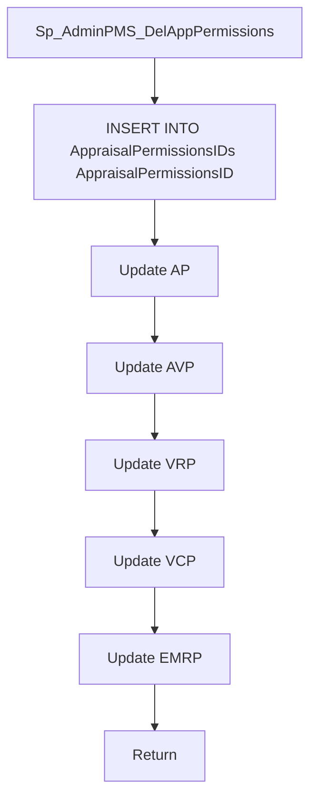

# Sp_AdminPMS_DelAppPermissions

## What it does

Stored procedure `Sp_AdminPMS_DelAppPermissions`. Writes `AP`, `AVP`, `VRP`, `VCP`, `EMRP`. Reads `TPMSAppraisalPermissions`, `TPMSAppraisalViewManagerPermissions`, `TPMS_ViewManagerRatingPermissions`, `TPMS_ViewManagerCommentsPermissions`, `TPMS_ViewEmpManagerRatingPermissions`. Calls no other procedure or function.

## Parameters

| Name | Direction | What it is for |
|---|---|---|
| `@AppraisalPermissionsID` | in | Varchar(2000) |
| `@ModifiedBy` | in | Int |

## Call sequence

Calls no other procedures or functions.

## Callers

No other procedure or function calls this object.

## Nested

Calls no other procedures or functions.

## Steps

1. Script is `HRMS-DATABASE/HRMS/STOREPROCEDURE/Sp_AdminPMS_DelAppPermissions.sql`.
2. INSERT INTO @AppraisalPermissionsIDs (AppraisalPermissionsID)
3. Update AP
4. Update AVP
5. Update VRP
6. Update VCP
7. Update EMRP

## Tables

| Table | Read or write |
|---|---|
| `AP` | write |
| `AVP` | write |
| `EMRP` | write |
| `TPMSAppraisalPermissions` | read |
| `TPMSAppraisalViewManagerPermissions` | read |
| `TPMS_ViewEmpManagerRatingPermissions` | read |
| `TPMS_ViewManagerCommentsPermissions` | read |
| `TPMS_ViewManagerRatingPermissions` | read |
| `VCP` | write |
| `VRP` | write |

## Flow

