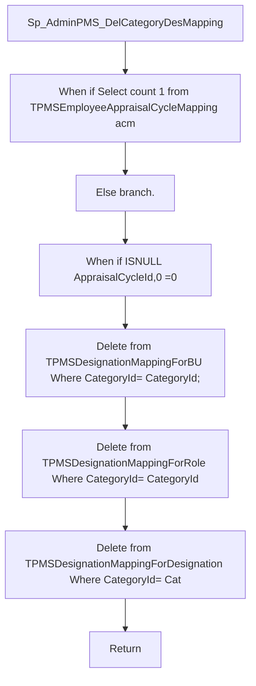

# Sp_AdminPMS_DelCategoryDesMapping

## What it does

Stored procedure `Sp_AdminPMS_DelCategoryDesMapping`. Writes `TPMSDesignationMappingForBU`, `TPMSDesignationMappingForRole`, `TPMSDesignationMappingForDesignation`, `TPMSCategoryDesignationMapping`, `TPMSEmployeeGoalSettingTemplate`, `TPMSEmployeeGoalSettingDetails`. Reads `TPMSEmployeeAppraisalCycleMapping`, `TPMSAppraisalCycles`. Calls no other procedure or function.

## Parameters

| Name | Direction | What it is for |
|---|---|---|
| `@CategoryId` | in | int |
| `@EmployerId` | in | int |
| `@AppraisalCycleId` | in | int |
| `@GoalSettingId` | in | INT |

## Call sequence

Calls no other procedures or functions.

## Callers

No other procedure or function calls this object.

## Nested

Calls no other procedures or functions.

## Steps

1. Script is `HRMS-DATABASE/HRMS/STOREPROCEDURE/Sp_AdminPMS_DelCategoryDesMapping.sql`.
2. When if (Select count(1) from TPMSEmployeeAppraisalCycleMapping acm
3. Else branch.
4. When if(ISNULL(@AppraisalCycleId,0) =0)
5. Delete from TPMSDesignationMappingForBU Where CategoryId=@CategoryId;
6. Delete from TPMSDesignationMappingForRole Where CategoryId=@CategoryId;
7. Delete from TPMSDesignationMappingForDesignation Where CategoryId=@CategoryId;
8. Delete from TPMSCategoryDesignationMapping Where CategoryId=@CategoryId and EmployerId=@EmployerId;
9. Else branch.
10. Delete from TPMSDesignationMappingForBU Where CategoryId=@CategoryId and AppraisalCycleId=@AppraisalCycleId;
11. Delete from TPMSDesignationMappingForRole Where CategoryId=@CategoryId and AppraisalCycleId=@AppraisalCycleId;
12. Delete from TPMSDesignationMappingForDesignation Where CategoryId=@CategoryId and AppraisalCycleId=@AppraisalCycleId;
13. Delete from TPMSCategoryDesignationMapping Where CategoryId=@CategoryId and EmployerId=@EmployerId and AppraisalCycleId=@AppraisalCycleId;
14. Else branch.
15. Delete from TPMSDesignationMappingForBU Where CategoryId=@CategoryId and GoalSettingId=@GoalSettingId;
16. Delete from TPMSDesignationMappingForRole Where CategoryId=@CategoryId and GoalSettingId=@GoalSettingId;
17. Delete from TPMSDesignationMappingForDesignation Where CategoryId=@CategoryId and GoalSettingId=@GoalSettingId;
18. Delete from TPMSCategoryDesignationMapping Where CategoryId=@CategoryId and EmployerId=@EmployerId and GoalSettingId=@GoalSettingId;
19. delete from TPMSEmployeeGoalSettingTemplate where GoalSettingId =@GoalSettingId and FormId=@CategoryId
20. delete from TPMSEmployeeGoalSettingDetails where GoalSettingId =@GoalSettingId and FormId=@CategoryId

## Tables

| Table | Read or write |
|---|---|
| `TPMSAppraisalCycles` | read |
| `TPMSCategoryDesignationMapping` | read and write |
| `TPMSDesignationMappingForBU` | read and write |
| `TPMSDesignationMappingForDesignation` | read and write |
| `TPMSDesignationMappingForRole` | read and write |
| `TPMSEmployeeAppraisalCycleMapping` | read |
| `TPMSEmployeeGoalSettingDetails` | read and write |
| `TPMSEmployeeGoalSettingTemplate` | read and write |

## Flow

