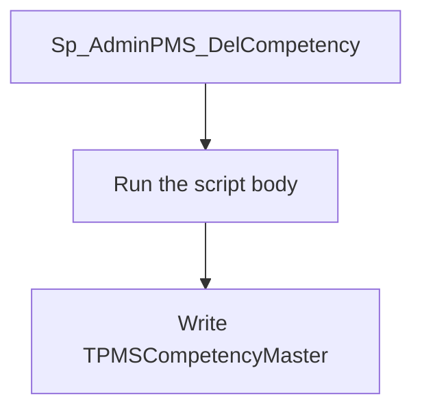

# Sp_AdminPMS_DelCompetency

## What it does

Deletes a competency only when no form section still references it.

## Parameters

| Name | Direction | What it is for |
|---|---|---|
| `@CompetencyId` | in | Competency Id |
| `@EmployerId` | in | Employer Id |

## Call sequence

Calls no other procedures or functions.

## Callers

No other procedure or function calls this object.

## Nested

Calls no other procedures or functions.

## Steps

Script: `HRMS-DATABASE/HRMS/STOREPROCEDURE/Sp_AdminPMS_DelCompetency.sql`.

1. If (Select Count(1) From TPMSCategoryCompetencies cc Where cc.CompetencyId=@CompetencyId)>0
2. Select 0 DeleteStatus
3. Update TPMSCompetencyMaster
4. Select 1 DeleteStatus

## Tables

| Table | Read or write |
|---|---|
| `TPMSCompetencyMaster` | write |
| `TPMSCategoryCompetencies` | read |

## Flow

