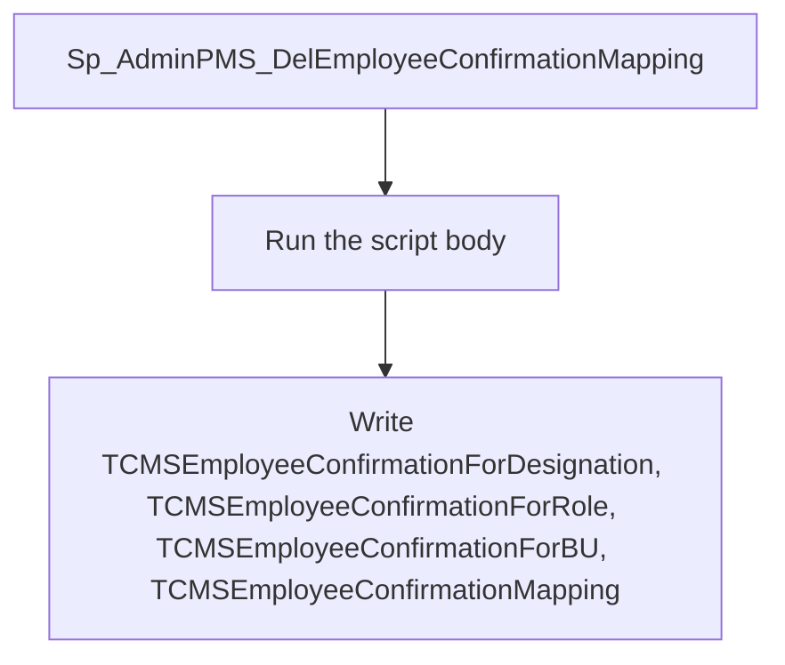

# Sp_AdminPMS_DelEmployeeConfirmationMapping

## What it does

Deletes a confirmation form mapping and its designation, role, and business-unit rows.

## Parameters

| Name | Direction | What it is for |
|---|---|---|
| `@ConfirmationMappingId` | in | Confirmation Mapping Id |
| `@EmployerId` | in | Employer Id |

## Call sequence

Calls no other procedures or functions.

## Callers

No other procedure or function calls this object.

## Nested

Calls no other procedures or functions.

## Steps

Script: `HRMS-DATABASE/HRMS/STOREPROCEDURE/Sp_AdminPMS_DelEmployeeConfirmationMapping.sql`.

1. if (Select count(1) from TCMSEmployeeConfirmationMapping where Employerid=@EmployerId and ConfirmationMappingId=@ConfirmationMappingId)=0
2. Select 0 DeleteStatus
3. Delete from TCMSEmployeeConfirmationForDesignation Where ConfirmationMappingId=@ConfirmationMappingId;
4. Delete from TCMSEmployeeConfirmationForRole Where ConfirmationMappingId=@ConfirmationMappingId;
5. Delete from TCMSEmployeeConfirmationForBU Where ConfirmationMappingId=@ConfirmationMappingId;
6. Delete from TCMSEmployeeConfirmationMapping Where ConfirmationMappingId=@ConfirmationMappingId;
7. Select 1 DeleteStatus

## Tables

| Table | Read or write |
|---|---|
| `TCMSEmployeeConfirmationForDesignation` | read/write |
| `TCMSEmployeeConfirmationForRole` | read/write |
| `TCMSEmployeeConfirmationForBU` | read/write |
| `TCMSEmployeeConfirmationMapping` | read/write |

## Flow

