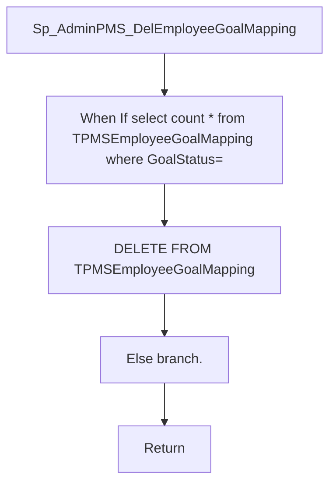

# Sp_AdminPMS_DelEmployeeGoalMapping

## What it does

Stored procedure `Sp_AdminPMS_DelEmployeeGoalMapping`. Writes `TPMSEmployeeGoalMapping`. Calls no other procedure or function.

## Parameters

| Name | Direction | What it is for |
|---|---|---|
| `@EmployeeId` | in | varchar(max) |
| `@GoalSettingId` | in | int |

## Call sequence

Calls no other procedures or functions.

## Callers

No other procedure or function calls this object.

## Nested

Calls no other procedures or functions.

## Steps

1. Script is `HRMS-DATABASE/HRMS/STOREPROCEDURE/Sp_AdminPMS_DelEmployeeGoalMapping.sql`.
2. When If((select count(*) from TPMSEmployeeGoalMapping where GoalStatus='Initiated' and GoalSettingId=@GoalSettingId)=0)
3. DELETE FROM TPMSEmployeeGoalMapping
4. Else branch.

## Tables

| Table | Read or write |
|---|---|
| `TPMSEmployeeGoalMapping` | read and write |

## Flow

