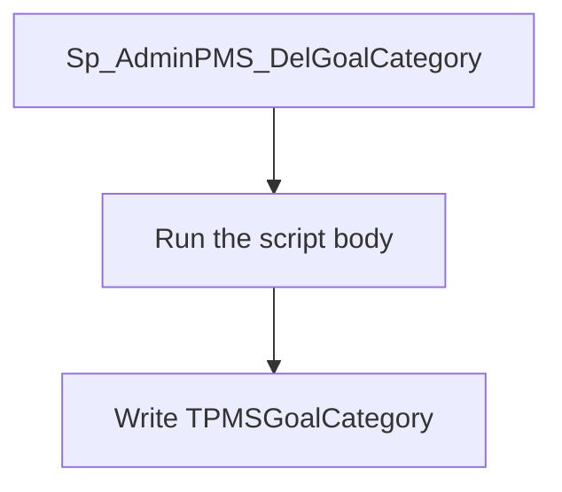

# Sp_AdminPMS_DelGoalCategory

## What it does

Deletes a goal or KRA category only when forms, appraisals, and goal mappings do not still reference it.

## Parameters

| Name | Direction | What it is for |
|---|---|---|
| `@Categoryid` | in | Categoryid |
| `@Employerid` | in | Employerid |

## Call sequence

Calls no other procedures or functions.

## Callers

No other procedure or function calls this object.

## Nested

Calls no other procedures or functions.

## Steps

Script: `HRMS-DATABASE/HRMS/STOREPROCEDURE/Sp_AdminPMS_DelGoalCategory.sql`.

1. If (select count(1)
2. Select 1 ErrorCode
3. else if(SELECT count(1)
4. Select 1 ErrorCode
5. update TPMSGoalCategory
6. Select 0 ErrorCode

## Tables

| Table | Read or write |
|---|---|
| `TPMSGoalCategory` | read/write |
| `TPMSCategoryMaster` | read |
| `TPMSCategorySections` | read |
| `TPMSCategoryGoalKRAs` | read |
| `TPMSGoalCategoryDetails` | read |
| `TPMSEmployeeAppraisalCycleMapping` | read |
| `TPMSEmployeeSelfAppraisal` | read |
| `TPMSAppraisalCycles` | read |
| `TPMSEMPLOYEEGOALMAPPING` | read |

## Flow

