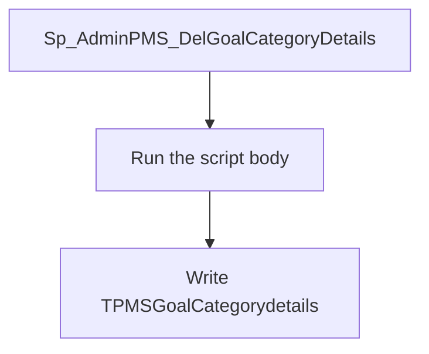

# Sp_AdminPMS_DelGoalCategoryDetails

## What it does

Runs Sp_AdminPMS_DelGoalCategoryDetails.

## Parameters

| Name | Direction | What it is for |
|---|---|---|
| `@CategoryDetailsId` | in | Category Details Id |
| `@Employerid` | in | Employerid |

## Call sequence

Calls no other procedures or functions.

## Callers

No other procedure or function calls this object.

## Nested

Calls no other procedures or functions.

## Steps

Script: `HRMS-DATABASE/HRMS/STOREPROCEDURE/Sp_AdminPMS_DelGoalCategoryDetails.sql`.

1. If (Select count(1) From TPMSGoalCategorydetails Where Categorydetailsid =@CategoryDetailsId and IsDeleted =1)=1
2. Select 1 ErrorCode
3. Else if((Select count(1)
4. Select 1 ErrorCode
5. update TPMSGoalCategorydetails
6. Select 0 ErrorCode

## Tables

| Table | Read or write |
|---|---|
| `TPMSGoalCategorydetails` | read/write |
| `TPMSCategoryMaster` | read |
| `TPMSCategorySections` | read |
| `TPMSCategoryGoalKRAs` | read |

## Flow

