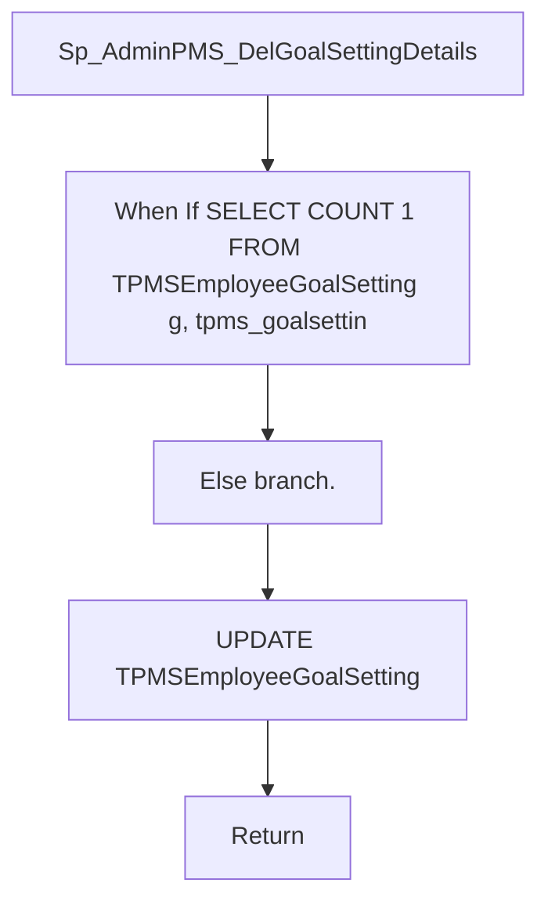

# Sp_AdminPMS_DelGoalSettingDetails

## What it does

Stored procedure `Sp_AdminPMS_DelGoalSettingDetails`. Writes `TPMSEmployeeGoalSetting`. Calls no other procedure or function.

## Parameters

| Name | Direction | What it is for |
|---|---|---|
| `@GoalSettingId` | in | Int |

## Call sequence

Calls no other procedures or functions.

## Callers

No other procedure or function calls this object.

## Nested

Calls no other procedures or functions.

## Steps

1. Script is `HRMS-DATABASE/HRMS/STOREPROCEDURE/Sp_AdminPMS_DelGoalSettingDetails.sql`.
2. When If (SELECT COUNT(1) FROM TPMSEmployeeGoalSetting g, tpms_goalsettingreviewfrequency rf
3. Else branch.
4. UPDATE TPMSEmployeeGoalSetting

## Tables

| Table | Read or write |
|---|---|
| `TPMSEmployeeGoalSetting` | read and write |

## Flow

